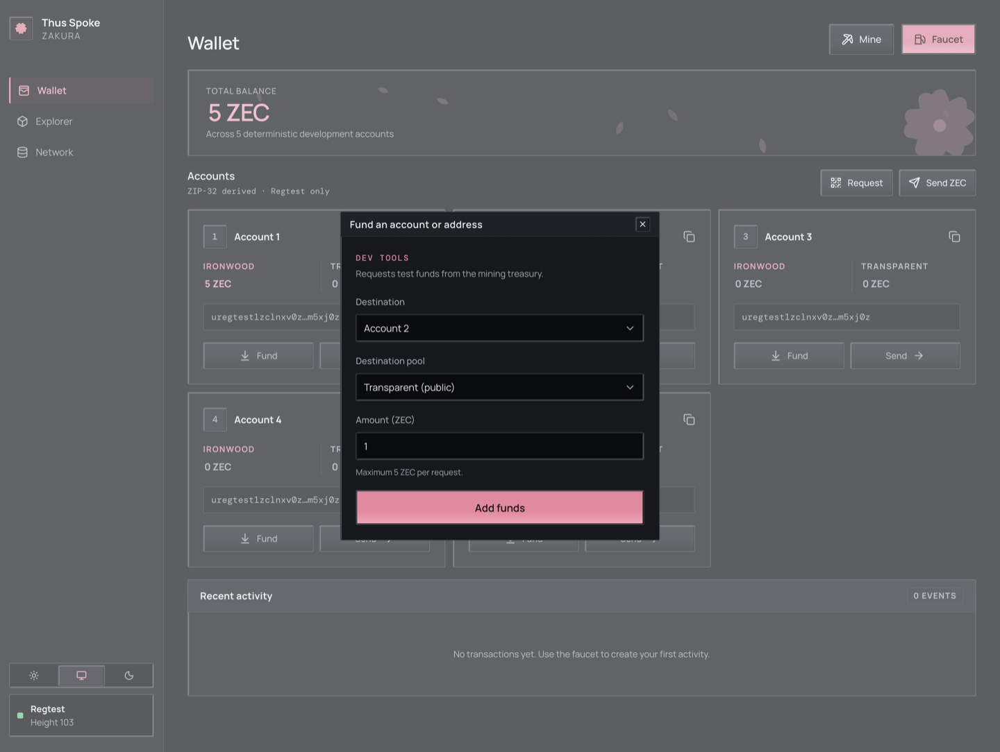
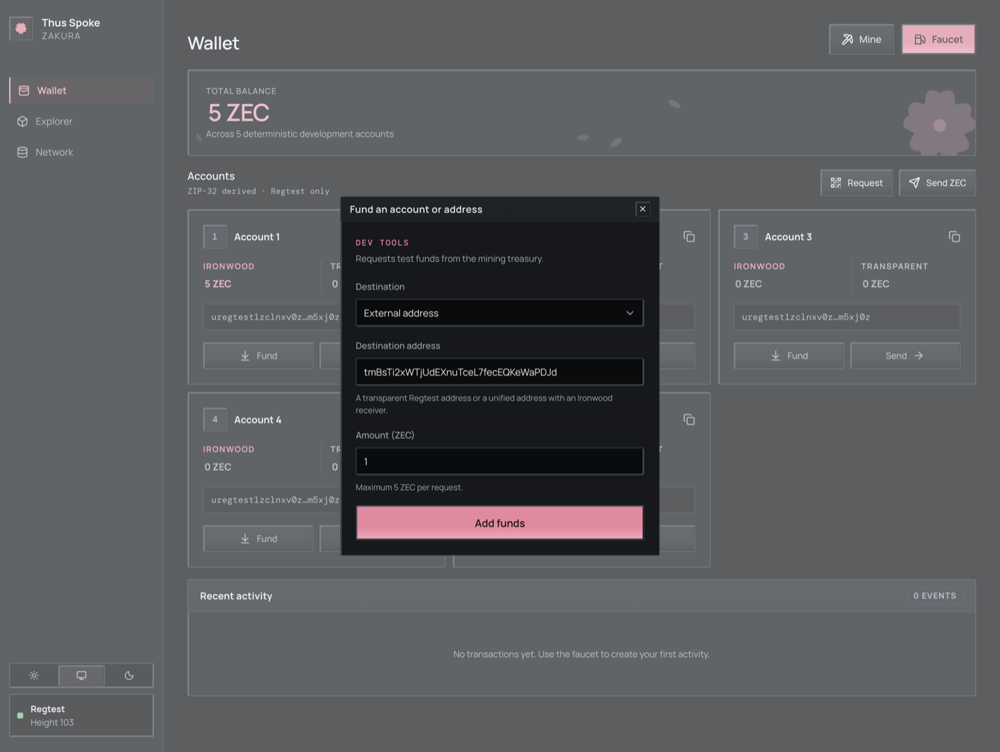
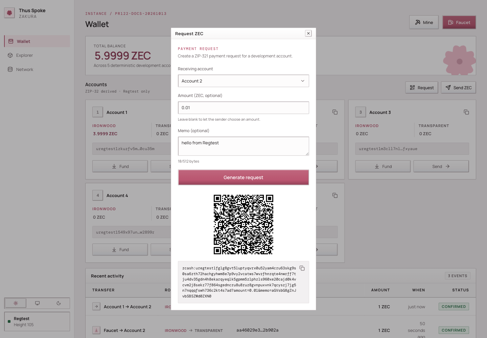
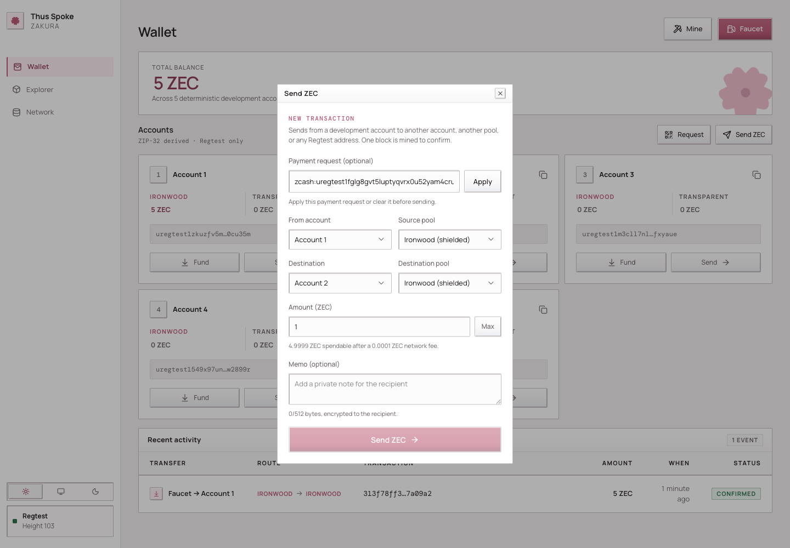
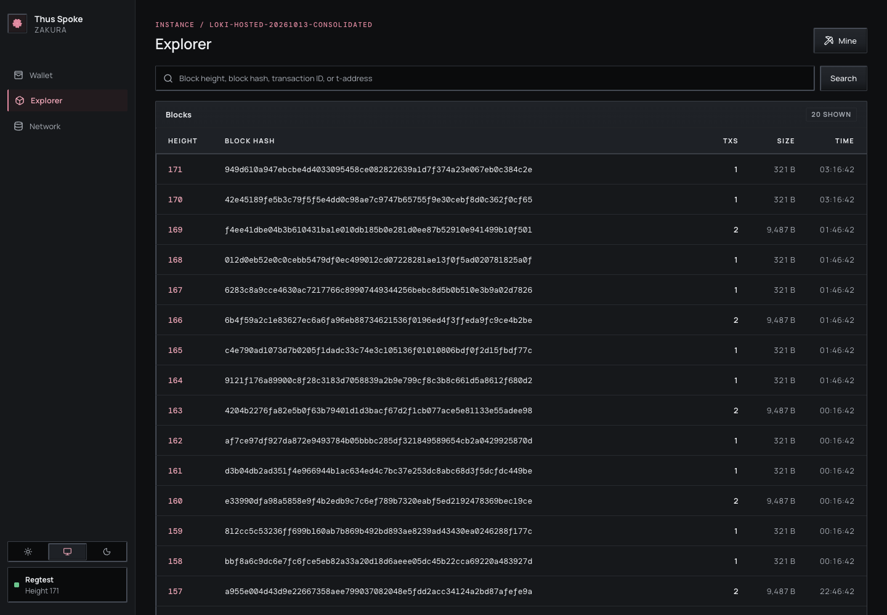
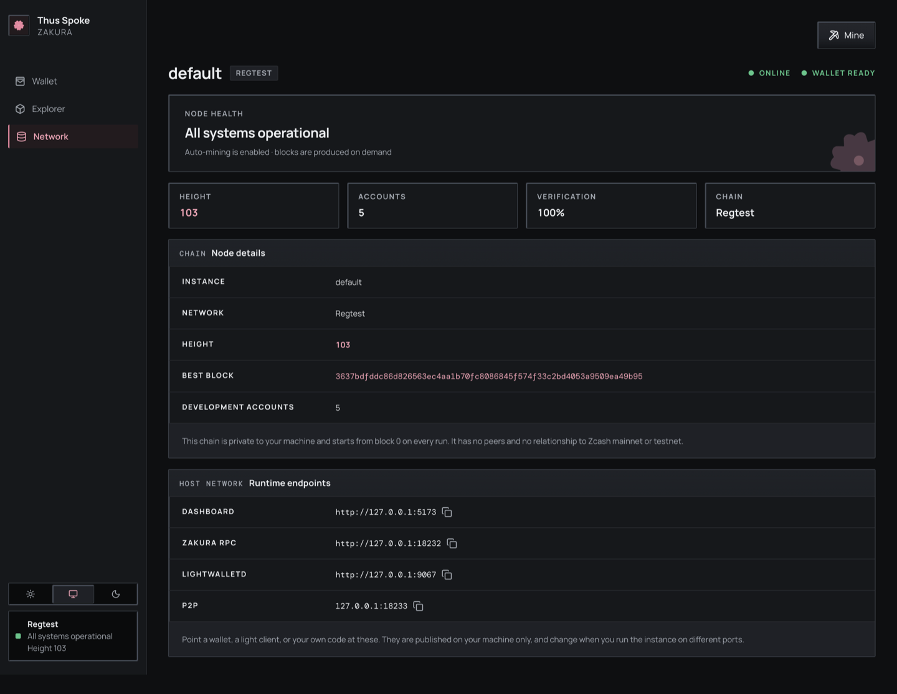
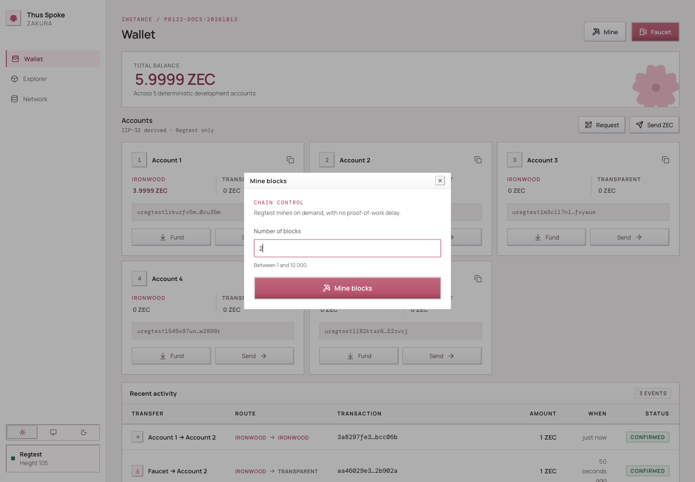
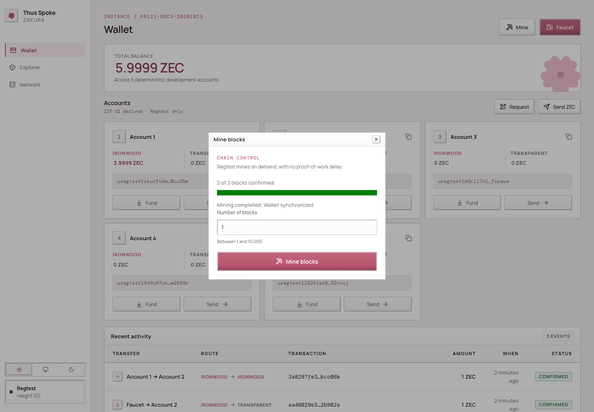

# Thus Spoke Zakura

> A disposable Zcash Regtest network for local development: a launcher, a node, lightwalletd, and a wallet-backed dashboard, all in Docker on loopback.

Every chapter, in reading order. The pages are also published separately; see https://amiabix.github.io/thus-spoke-zakura-book/llms.txt

---

# Thus Spoke Zakura

Thus Spoke Zakura (`ths`) gives you a disposable Zcash **Regtest** network on
your own machine. You can mine blocks, fund development accounts, send test ZEC,
inspect transactions, and connect another application. The launcher runs
Zakura, lightwalletd, and a wallet-backed dashboard in Docker. Every
host-published endpoint stays on `127.0.0.1`.

This book teaches **why each part exists and what happens when you use it**.
The chapters build on one another. The [`ths` CLI reference](cli.md),
[development guide](development.md), and [troubleshooting guide](troubleshooting.md)
are there when you need a particular command or diagnosis.

## Who this book is for

You should be comfortable running terminal commands and reading a small HTTP
example. You do not need prior Zcash knowledge. We define Regtest, blocks,
accounts, pools, notes, and wallet synchronization before relying on them.

Everything here is local development infrastructure. Regtest coins and keys
have no value on mainnet or testnet — and the keys are not secret either. The
seed is a fixed constant in the source, so every instance on every machine
derives the same accounts, and anyone who knows this project can derive them
too. That reproducibility is the point; it is also why **nothing of value may
ever touch an address shown by this environment.**

Use the [installer](getting-started.md#install-the-launcher) as the default
setup path. The installer downloads a published release. Use the [source build instructions](development.md)
to run the recorded source baseline.

## One experiment, several chapters

We will start the default instance, look at its five user accounts, fund
Account 2, send from Account 1 to Account 2, mine another block, and read the
result through the API. Along the way, we will answer three questions:

1. **Who owns this fact?** Zakura owns the chain, lightwalletd indexes it,
   the wallet owns spendable balances, and SQLite records development activity.
2. **When is it true?** A block can exist before lightwalletd indexes it, and
   the index can advance before the wallet publishes a fresh balance snapshot.
3. **What can be retried?** The caller and operation determine which identity
   to retain and which state to inspect after an uncertain response. [Chapter
   6](architecture/operations.md) traces those boundaries.

Those distinctions explain most surprising behavior in the dashboard.

## How to read

Read [Chapter 1: Your first instance](getting-started.md) if you want to work
along. [Chapter 2](architecture/overview.md) defines the components;
[Chapter 3](accounts-and-balances.md) defines wallet state; [Chapter
4](using-the-dashboard.md) moves funds; [Chapter 5](mining-and-sync.md) follows
a block into the wallet; [Chapter 6](architecture/operations.md) deals with
uncertain responses; and [Chapter 7](connect-an-app.md) connects your code.

A chapter starts with the idea, traces the flow, then gives a concrete action
and what you should observe. Diagrams have text explanations beside them so
the sequence still works without images.

## Four terms to keep separate

| Term | In this book |
| --- | --- |
| **Instance** | One named set of Regtest containers, network, volumes, ports, and disposable data controlled by `ths`. |
| **Node tip** | Zakura's latest block height **and hash**. A height alone does not identify a block after a reorganization. |
| **Wallet snapshot** | The server's last reconciled view of user-account balances. The dashboard reads this through the accounts API. |
| **Activity** | A SQLite record of a faucet or send request, its transaction ID, and its confirmation status. It is not a balance ledger. |

**Next:** [start a fresh instance](getting-started.md).

---

# 1. Your first instance

In this chapter you will start one private chain, identify its endpoints, and
watch a second one be thrown away. The next chapter will explain what the
three services behind those endpoints do.

An **instance** is one named set of Docker containers, a private Docker
network, volumes, and host ports. The default name is `default`. Starting it
again creates a **fresh** chain and wallet after cleanup succeeds; stopping
it requests deletion of its data. Check the command result before assuming
cleanup completed.

An **image** is the built template from which Docker starts a container;
changing source files does not alter an image that already exists.


1. `ths` checks Docker and the required images.
2. It removes leftovers for the selected instance name, then creates its
   network, volumes, and containers. Other names are untouched.
3. An init container creates the seed, account records, wallet database, and
   Zakura Regtest configuration. Zakura starts, then lightwalletd, then the
   app.
4. The app synchronizes its wallet and provisions Account 1. The launcher
   prints the ready line and endpoints after its app readiness probe succeeds.
5. Ctrl+C, a termination signal, or a partial startup failure triggers cleanup
   of that instance's resources and metadata. Check the command result;
   failed or uncertain cleanup retains recovery metadata.

## Prepare Docker

Install Docker Desktop on macOS or Docker Engine/Desktop on Linux. Start it
and confirm that both the client and daemon respond:

```console
docker version
```

The server section must respond without `sudo`. If it does not, fix Docker
access before continuing. `ths doctor` performs the same basic Docker
reachability check after installation.

## Install the launcher

The installer supports Intel and ARM macOS and Linux. It verifies the
release archive's SHA-256 digest, installs `ths` in `~/.local/bin` by default,
and pulls matching runtime images:

```console
curl --proto '=https' --tlsv1.2 -fsSL https://raw.githubusercontent.com/zcashlabs/thus-spoke-zakura/main/install.sh | sh
ths --version
ths doctor
```

The unpinned command selects the latest published release. To explicitly
request an exact release version, such as **0.3.0**, set `THS_VERSION` on
the installer process:

```console
curl --proto '=https' --tlsv1.2 -fsSL https://raw.githubusercontent.com/zcashlabs/thus-spoke-zakura/main/install.sh | THS_VERSION=0.3.0 sh
```

The installer reads three environment variables: `THS_INSTALL_DIR` chooses the
destination directory (default `~/.local/bin`), `THS_VERSION` installs an exact
release instead of the latest, and `THS_SKIP_IMAGE_PULL=1` skips the image
download. The image pull happens **before** the binary is moved into place, so
if Docker is not running the installer aborts with nothing installed. Start
Docker first, or install with `THS_SKIP_IMAGE_PULL=1` and run `ths pull` later.

If your shell says `ths: command not found`, either the install aborted or
`~/.local/bin` is not on `PATH`. See [troubleshooting](troubleshooting.md) for
the exact checks.

If you are working from a clone, use the [source build
instructions](development.md) instead. The launcher uses Docker images, so a
source edit does not automatically change a running app.

## Start the running example

Open a terminal and run it there. Keep that terminal open; `--no-open` only
skips opening the browser, and the dashboard still runs. The launcher ends
with:

```console
$ ths start --no-open
default is ready 🌸
  Dashboard    http://127.0.0.1:32805
  Zakura RPC   http://127.0.0.1:18232
  lightwalletd http://127.0.0.1:9067  (network=regtest, tls=false)
  P2P          127.0.0.1:18233
```

There is no fixed `sleep` interval that means the wallet is ready; wait for
`default is ready`. Startup time depends on Docker, image availability,
reward maturity, indexing, and wallet synchronization.

## What scrolls past before that line

Everything above `default is ready` is the launcher narrating its work, and
it is noisier than the result. You will see `Preparing a fresh default
environment…`, `Starting default…`, then raw Docker network, volume, and
container IDs, because `ths` lets Docker write to your terminal directly.

Interleaved with those IDs, the init container prints the instance's
**secrets**: a `⚠ DISPOSABLE REGTEST SECRETS` banner, the BIP-39 mnemonic,
and for each of the five development accounts its unified address and its
**unified spending key** in hex. That is deliberate. These are the supported
way to import one of these accounts into an external wallet, and they are
safe to print because they protect nothing — [Chapter
3](accounts-and-balances.md#an-account-is-a-wallet-identity) explains why.

## A fresh chain already has 103 blocks

Before Account 1 can hold anything, the treasury must have a *spendable*
mining reward, and a coinbase reward is not spendable until it has matured
by `COINBASE_MATURITY_BLOCKS` (100) confirmations. So startup mines through
maturity, shields a reward into the treasury, and pays Account 1 its 5
Ironwood ZEC. A newly ready instance therefore sits at height **103**, with
the wallet fully scanned to the same height. Nothing is wrong; the Network
page just does not start at 0.

## Read the endpoints from a second terminal

In a **second terminal**, inspect the same instance:

```console
$ ths status
default: running
  Dashboard    http://127.0.0.1:32805
  Zakura RPC   http://127.0.0.1:18232
  lightwalletd http://127.0.0.1:9067  (network=regtest, tls=false)
  P2P          127.0.0.1:18233
```

`ths status` reports the combined app, Zakura, and lightwalletd container state
and prints endpoints. It exits nonzero unless all three services are running.
It does **not** report the node height or wallet scan status; use `ths wait`
when a script needs the node, index, and wallet settled at one tip.
`ths endpoints --json` reports these keys:

| Key | Owner and purpose |
| --- | --- |
| `dashboard` | HTTP URL for the React UI and `/api/v1/` server API. |
| `rpc` | Zakura's local JSON-RPC URL. |
| `lightwalletd` | Plaintext lightwalletd gRPC endpoint for local clients. |
| `p2p` | Zakura's local peer address. |
| `network` | The chain this instance runs: always `"regtest"`. |
| `tls` | Always `false`; nothing here uses TLS. |

`ths start` uses **fixed defaults**, all published on `127.0.0.1`: dashboard
`32805`, Zakura RPC `18232`, P2P `18233`, lightwalletd `9067`. They do not
change between runs, and the launcher never picks a substitute — if one is
occupied, startup fails and names it. `ths start --port-offset <N>` shifts
all four by `N`, which must be a multiple of 10; that is the only thing that
moves them. Scripts should still read `ths endpoints --json` rather than
hard-code a port, because a given instance may have been started with an
offset. `ths open` opens the dashboard for you.

The dashboard's Network page or `GET /api/v1/status` shows node height and
wallet sync state if you need more than process status.

## Give another experiment its own name

A second instance needs its own ports. Since every `ths start` wants the same
four defaults, the name alone is not enough:

```console
$ ths --name alice start --no-open
Preparing a fresh alice environment…
Starting alice…
Error: port 32805 is already in use on 127.0.0.1
```

Give it an offset instead:

```console
$ ths --name alice start --no-open --port-offset 10
alice is ready 🌸
  Dashboard    http://127.0.0.1:32815
  Zakura RPC   http://127.0.0.1:18242
  lightwalletd http://127.0.0.1:9077  (network=regtest, tls=false)
  P2P          127.0.0.1:18243
```

Address that instance with the same global option:

```console
ths --name alice status
ths --name alice endpoints --json
```

Each name gets its own chain, wallet, volumes, and cleanup. The offset belongs
to the `start` that created the instance; later commands find its ports from
the instance record.

## Stop deliberately

Stopping is not a crash to recover from — it is how the environment is meant
to end. Try it on `alice`, which you do not need again. Return to the
terminal running it and press **Ctrl+C**. The launcher attempts to delete
that instance's containers, volumes, chain, seed, keys, and test funds.
Check the command result before assuming deletion completed. `default` is
untouched. If you need a result out of an instance, copy it out before stopping.

You can also run `ths --name alice stop` from another terminal. Once ready,
the foreground launcher watches the allocated app container by ID: deletion
by `stop` or `reset` ends that run without a second cleanup pass. A Docker
inspection error is unknown state, not proof of deletion.

If an interrupted process left resources behind, `ths --name alice reset
--force` attempts cleanup of only `alice` and its volumes. Verified deletion
is irreversible; failed or uncertain cleanup retains recovery metadata as
described above. Never use Regtest addresses or keys for real ZEC, and never
publish these local services beyond loopback.

**Leave `default` running.** [Chapter 4](using-the-dashboard.md) funds and
spends on it. If you do stop it, start it again with `ths start --no-open`;
after successful cleanup you will get a fresh funded chain with the same five
accounts, but every block, transaction, and balance from this run will be gone.

**What you learned:** `ths` controls an instance, not a persistent wallet.
Data belongs to a particular run, and the ports belong to the instance's
offset. **Next:** [meet the services inside the
instance](architecture/overview.md).

---

# 2. Components and state

Chapter 1 started an instance and printed four endpoints. Now we will
follow those endpoints inward. The important question is not merely which
container handles a request, but **which component owns the answer**.

A **block** is a unit of chain history. The **node tip** is Zakura's latest
block height and hash. The **mempool** holds transactions the node knows
about before they are included in a block. A **wallet** scans chain data for
funds it can spend. A wallet can lag the node even when both services are
healthy.


1. `ths` supervises a Zakura container, a lightwalletd container, and an app
   container on an instance-specific Docker network.
2. Zakura owns Regtest blocks, mempool, and JSON-RPC. lightwalletd follows
   Zakura and serves compact blocks to wallet clients over gRPC.
3. The app runs `ths-server`. It serves both `/api/v1/` and the built React
   dashboard, owns the wallet databases, and uses lightwalletd to scan and
   broadcast.
4. A browser or local program reaches only the loopback-published ports.
   Internal container listeners can use `0.0.0.0` inside the private network;
   every host-published service binds to `127.0.0.1`.

## The five owners of information

| Component | Owns | Read it through |
| --- | --- | --- |
| Zakura | Canonical chain, block height and hash, mempool, transaction lookup | JSON-RPC or the server's explorer API |
| lightwalletd | Compact-block index and gRPC stream over the node's chain | A lightwalletd-compatible wallet client |
| Wallet SDK in `ths-server` | Scanned notes, transparent outputs, and spendable balances in `wallet.db` | The server's wallet snapshot and accounts API |
| Server SQLite store | Seed, derived account records, activity, and idempotency keys in `ths.db` | Server API and local development commands |
| Browser | UI state and a query cache of server responses | Wallet, Explorer, and Network pages |

The app's wallet and SQLite files share the instance's `wallet` volume, but
they answer different questions. `wallet.db` tells the wallet what it has
scanned and can spend. `ths.db` records which development request produced a
transaction ID. Activity cannot reconstruct a balance.


1. Zakura advances the node tip. lightwalletd indexes compact blocks from
   that chain.
2. The server wallet scans through lightwalletd and compares its checkpoint
   height **and hash** with Zakura before publishing a fresh account snapshot.
   If the chain reorganizes, it rewinds to a common block and scans again.
3. `GET /api/v1/accounts` reads the server snapshot. The dashboard's query
   hooks fetch that endpoint. Server-sent `wallet`, `chain`, and `sync` events
   tell the hooks to refetch, rather than carrying balances themselves.
4. SQLite activity records a send or faucet request's transaction ID and
   confirmation status. `GET /api/v1/activity` reads it separately.

This ordering explains a common observation: the Network page may show a new
node height while Wallet still shows the last known balances. The wallet must
wait for indexing and scanning, and the server must validate the chain
checkpoint. `GET /api/v1/status` reports `wallet_sync.state` as `syncing`,
`ready`, or `error`, along with observed and scanned heights and hashes.
When synchronization fails, the last snapshot may remain visible. Treat it as
stale until the server reaches `ready`.

## Startup and data ownership

The app image first runs `init`. It creates `ths.db`, `wallet.db`, the seed,
six derived account records, and a Regtest Zakura configuration.
- Account 6 is the hidden mining and faucet treasury.
- Accounts 1–5 are exposed as user accounts.

The node mines to the treasury's transparent address. Normal transparent-output queries cover user accounts; treasury rewards are discovered when a faucet payment needs replenishment.

The instance also has separate `chain`, `lightwalletd`, and `config`
volumes. `ths` attempts instance-scoped cleanup on shutdown, interruption,
or startup failure. It reports success only after verifying cleanup.
Zakura runs with `ZAKURA_STATE__CACHE_DIR=/data`, so its state uses the `chain`
volume mounted at `/data` instead of the image's default cache directory.

Recovery records allocation identities as well as resource names. A known
original container ID can be checked and removed without adopting a same-name
replacement.

For the exact container and endpoint lifecycle, revisit [Chapter
1](getting-started.md). For the meaning of an account
balance, continue to [Chapter 3](accounts-and-balances.md).

**Source map:** [launcher runtime](https://github.com/zcashlabs/thus-spoke-zakura/tree/main/crates/ths-cli/src/runtime),
[server startup](https://github.com/zcashlabs/thus-spoke-zakura/blob/main/crates/ths-server/src/bootstrap.rs),
[wallet snapshot](https://github.com/zcashlabs/thus-spoke-zakura/blob/main/crates/ths-server/src/sync.rs),
[reconciliation](https://github.com/zcashlabs/thus-spoke-zakura/blob/main/crates/ths-server/src/reconcile.rs),
and [dashboard queries](https://github.com/zcashlabs/thus-spoke-zakura/blob/main/web/src/hooks/queries.ts).

**Next:** [accounts, pools, and balances](accounts-and-balances.md).

---

# 3. Accounts and balances

The previous chapter separated chain state from wallet state. This chapter
explains what the wallet is counting. When you later send 1 ZEC, you should be
able to predict **which account and pool** will change, and why a displayed
total is not always spendable.

## An account is a wallet identity

The app initializes six deterministic wallet accounts from one disposable
seed:

- Accounts **1–5** are development accounts.
- Account **6** is a hidden treasury used for mining rewards and faucet payments.

The accounts API, Wallet page, account selector, and user-facing balances
expose only 1–5.

Each user account has a transparent address and a unified address. For the
flows in this book, selecting the **Transparent** destination pool uses the
transparent address; selecting **Ironwood** uses the unified address for a
shielded output. The server derives both from the instance's seed.

That seed is **fixed**: the server builds it from 32 zero bytes, which makes
the mnemonic the well-known `abandon abandon … art` phrase. Every instance,
on every machine, therefore derives the *same* six accounts and the same
addresses.

A different instance name gives you a different chain and different balances;
it does **not** give you different keys.

Use `ths wallet balances` or `GET /api/v1/accounts` to read the five addresses
for the instance you are using.

In the dashboard, select a Wallet account's name to inspect and copy its full
unified and transparent addresses. Its stable page is `/wallet/accounts/1`
through `/wallet/accounts/5`. The page also offers the unified full viewing key
when the server includes it; it never shows spending keys. Searching a known
local unified address in Explorer reaches this same account page. That is a
wallet identity lookup, not a public history lookup for a shielded address.

Say that plainly: these keys are public knowledge. Anyone who has read this
project can derive every address and every spending key your instance uses.
That is fine, because it is what makes the environment disposable and
reproducible — and it is exactly why nothing of value may ever touch these
addresses. Never send real ZEC to an address shown by this environment.

A **pool** is a way value is represented and spent, not a separate wallet.
Transparent value lives in unspent transaction outputs, or **UTXOs**; their
addresses and amounts are public chain data. Ironwood value lives in shielded
**notes**. The wallet learns which notes belong to it by scanning compact
blocks; the public explorer cannot identify their recipient or read a memo.

This Regtest chain activates NU7 at height 1. The API offers transparent and
Ironwood pools; it rejects `orchard` because Orchard no longer accepts deposits
under NU6.3. Ironwood is this chain's shielded pool;


1. Each user account can hold a transparent balance and an Ironwood balance.
   These are separate sources of funds, even though the dashboard also shows
   their sum.
2. The miner sends block rewards to Account 6's transparent address. Account
   6 never appears in a user account list or balance total.
3. The faucet can spend from Account 6 to a chosen user account and pool.
   A send between users spends the selected **source** account and pool and
   pays to the selected **destination** account and pool. The accounts may
   match when the pools differ; same-account/same-pool sends are rejected.
   An Ironwood send uses only Ironwood inputs; Sapling or legacy Orchard
   funds cannot cover a shortfall in the selected source pool.

## ZEC, zatoshi, and spendability

**ZEC** is the amount unit you enter in the UI and CLI.

**Zatoshi** is the integer unit used by the API: **1 ZEC = 100,000,000
zatoshi (10⁸)**.

For example, `0.5` ZEC is `50000000` zatoshi. Use integer zatoshi in JSON
requests so a decimal floating-point calculation does not choose the wrong
amount.

The accounts API returns `transparent_zatoshi` and `ironwood_zatoshi` for
each user account. These are the server's last reconciled **wallet
snapshot**, not numbers reconstructed from the block explorer. The dashboard
derives its displayed total from those fields.

A balance is not a promise that the next transaction can spend every zatoshi.
The wallet SDK selects actual outputs or notes, requires a sufficient scan,
and accounts for the transaction fee. Pending change and immature mining
rewards can also affect spendability. **Change** is the unspent remainder of a
selected input returned to the wallet; it may not be ready to spend
immediately. The current send strategy routes change into the source
account's Ironwood pool, including change from transparent inputs.

You do not have to guess how much room the fee needs. `POST /api/v1/send/quote`
builds a **dry-run proposal** for one account and pool pair. It returns
`available_zatoshi`, `fee_zatoshi`, and `max_zatoshi` for the current wallet
state:

```console
$ DASHBOARD_URL="$(ths endpoints --json | python3 -c 'import json,sys; print(json.load(sys.stdin)["dashboard"])')"
$ curl -fsS "$DASHBOARD_URL/api/v1/send/quote" -H 'content-type: application/json' \
    --data '{"from_account":1,"source_pool":"ironwood","destination_pool":"ironwood"}'
```

- `available_zatoshi` reports the funds available for one send before fees,
- `fee_zatoshi` reports its fee,
- and `max_zatoshi` reports the quoted maximum send amount.

A transparent send can use at most 1,333 eligible inputs. If an account holds
more, the quote's `available_zatoshi` can be lower than its full transparent
balance in `GET /api/v1/accounts`. **Max** uses the amount that fits in one
send after fees; the account balance is unchanged.

From a terminal, `ths wallet quote --from 1 --source-pool ironwood
--destination-pool ironwood` asks for the same quote and prints it in ZEC, or
in zatoshi with `--json`; see the
[CLI reference](cli.md#ths-wallet-quote---from-n---source-pool-pool---destination-pool-pool).

These values depend on the selected inputs and current wallet state; a quote
does not reserve funds or guarantee a later send succeeds. Compare an intended
amount against `max_zatoshi` rather than the displayed balance. When a send
fails anyway, check the **source pool** and inspect wallet sync status before
trying again.

At the end of startup, Account 1 has **5 Ironwood ZEC**. Account 2 starts
empty. In the next chapter, we will give Account 2 transparent funds and
then send it Ironwood funds from Account 1. That will make the two balances
visibly different.

## Where faucet funds come from

A faucet request does not mint coins directly into the destination. The
miner first pays rewards to the hidden treasury's transparent address. The
reward created by mining a block is called **coinbase**; it must mature
before it can be spent. When the treasury's spendable Ironwood funds are
insufficient, the server discovers needed mature rewards, shields them into
the treasury's Ironwood pool, confirms that shielding transaction, and retries
the faucet payment. This can move the node height by more than the one block
used to confirm the final faucet payment.


1. Zakura mines to Account 6's transparent address. The rewards are not
   user-account balances.
2. The server durably claims the request before asking the wallet SDK to
   prepare the treasury payment. On insufficient spendable Ironwood funds,
   it advances the chain as needed for reward maturity, discovers the required
   reward output, and shields it to Account 6's Ironwood funds. It retries
   the payment proposal.
3. The wallet and server save the prepared transaction bytes before the server
   broadcasts to the chosen user account and destination pool. It normally
   mines a confirming block. Each account faucet request is limited to **5 ZEC**.

Routine user wallet synchronization does not query all treasury transparent
outputs. Treasury discovery runs when replenishment needs it. The private
details stay out of the user account list, but the public chain may still
show transparent mining rewards and shielding value movement.

## Three views of the same experiment

After a payment, these views can temporarily disagree without being
contradictory:

| View | What it can establish |
| --- | --- |
| Network or Zakura RPC | Which block is the current node tip. |
| Recent activity | Which request and transaction ID the server recorded, and whether it has a confirming block hash. |
| Wallet account balance | What the server's reconciled wallet scan says the user account holds. |

Confirmed activity can precede wallet settlement because confirmation checks
and wallet synchronization run independently. Keep using the accounts snapshot
for balances.

Read [Chapter 5](mining-and-sync.md) for the precise order in which those
views catch up. The [architecture chapter](architecture/overview.md#the-five-owners-of-information)
maps each view to its owner.

**Next:** [fund Account 2 and send between pools](using-the-dashboard.md).

---

# 4. Fund and send

An account has separate transparent and Ironwood balances. The treasury funds
faucet requests. We will use the `default` instance from Chapter 1 to see both
in action. Keep `ths start --no-open` running in its first terminal; run the
commands below in a second terminal. If you stopped it, start it again for a
fresh chain with the same five accounts.

The dashboard has **Wallet**, **Explorer**, and **Network** pages. Use `ths
open` to bring it up. On desktop, the **Mine** button sits at the top of
each page; on a narrow screen you can always use `ths mine`.

## First, observe the starting state

Open **Wallet**. Account 1 should show **5 Ironwood ZEC** after startup;
Account 2 should have no funds. If balances have not appeared, inspect
`GET /api/v1/status` or follow [troubleshooting](troubleshooting.md) before
sending. The server wallet snapshot, not a browser calculation from chain
history, supplies these balances.


Select an account's name to open its detail page. The full unified address and
transparent address each have a copy button. The unified full viewing key is
also shown and copyable when the server supplies it; an older server that omits
the key simply has no viewing-key row. These pages cover development accounts
1–5 only.

Explorer also recognises those accounts. Searching the exact unified address of
a local account opens the same account page. Known transparent addresses in
transaction and address views have an **Account N** link beside their public
chain information. Unknown transparent addresses keep their normal Explorer
view; an unknown unified address still has no public chain-history page.
Viewing keys appear only on the account detail page, not in Explorer rows or
search results.

Two buttons open the faucet, and they are labelled differently. **Faucet**
in the page header is the general one, and it only appears on Wallet — the
Explorer and Network pages show just **Mine**. On each account card,
**Fund** opens the same dialog with that account preselected.

Recent activity ages update while the page is idle. This only refreshes the
displayed time; payment status still comes from the server.

## Fund Account 2's transparent pool

1. Select **Fund** on Account 2's card, or **Faucet** in the header.
2. In the **Fund an account or address** dialog, choose **Destination** Account 2,
   **Destination pool** Transparent, and **Amount (ZEC)** 1. Select
   **Add funds**.
3. Look at **Recent activity** for the transaction ID (`txid`), the unique
   identifier of the broadcast transaction, and its status. Once
   confirmed and the wallet snapshot catches up, Account 2's transparent
   balance should rise by 1 ZEC; its Ironwood balance is still separate.



The same operation from the second terminal is:

```console
ths wallet faucet --accounts 2 --amount 1 --pool transparent
```

Choose **either** the UI action or the CLI command if you want exactly one
faucet payment. Running both makes two payments. The faucet may mine extra
blocks first to mature and shield treasury rewards, then normally mines one
block to confirm the account payment. It accepts at most 5 ZEC **per account
per request**. If auto-mining fails, the recorded activity may remain
`broadcast`. [Chapter 6](architecture/operations.md)
compares these callers.

## Fund an external Regtest address

On Wallet, open **Faucet** and set **Destination** to **External address**.
Enter a transparent Regtest address or a unified Regtest address with an
Ironwood receiver, choose an amount of at most 5 ZEC, and select **Add funds**.
The dashboard checks the address with the server before submitting the
payment. If the response is lost, open **Payments** to resume the saved
request with the same idempotency key. Do not start a second request for the
same intended payment.



## Send Ironwood funds from Account 1 to Account 2

This is a **different** pool movement from the transparent faucet payment.

1. On Wallet, select **Send ZEC**.
2. Set **From account** to Account 1 and **Source pool** to Ironwood. Set
   **Destination** to Account 2 and **Destination pool** to Ironwood.
3. Enter **1** in **Amount (ZEC)**. Optionally enter `hello from Regtest`
   in **Memo (optional)**, then select **Send ZEC**.
4. Check Recent activity for the transaction ID and actual status. After
   confirmation and wallet settlement, Account 2 has 1 Ironwood ZEC **and**
   its earlier 1 transparent ZEC. Account 1's Ironwood balance falls by 1 ZEC
   **plus the fee**; do not expect it to be exactly 4 ZEC.

The dialog does the fee arithmetic for you. As soon as it has an account and
a pool it asks `POST /api/v1/send/quote`, and the hint under the amount field
shows the quoted spendable amount and network fee for that account and pool.
The **Max** button fills in that spendable figure. An amount above it is rejected.
An amount above 21,000,000 ZEC, the maximum supply, is rejected before the
request is sent.

Closing Send while the fee check is pending cancels that submission. A payment
already submitted keeps running and remains available through **Payments**.


CLI equivalent:

```console
ths wallet send --from 1 --to 2 --amount 1 --memo "hello from Regtest"
```

Inspect the returned txid, status, and any confirming block hash, then the
accounts snapshot for the actual pool balances and source fee. Choose either
the UI action or the command for one intended payment.


1. **Pair 1 — where the money comes from.** The source account is one of
   1–5, and the source pool decides what is spent: `transparent` spends
   that account's UTXOs, `ironwood` spends its shielded notes.
2. **Pair 2 — what the receiver gets.** Choose a **Destination** account
   from 1–5, or select **Other address** and fill in **Destination address**.
   For an account, `ironwood` pays its unified address and `transparent` pays
   its t-address. The account may match the source when the pools differ.
   For **Other address**, use a transparent Regtest address or a unified
   Regtest address with an Ironwood receiver. The dialog chooses
   **Destination pool** from the address and the server validates it before
   sending.
3. **The fee is on top of the amount**, taken from the source account. That
   is why `max_zatoshi` from the quote, not the balance, is the ceiling.
4. **A transparent source rarely spends exactly.** Transparent inputs must
   be spent whole, so the change comes back as an Ironwood note in the source
   account rather than as transparent change.
5. **Only an Ironwood destination carries a memo.** A transparent output has
   no memo field at all.

The memo is encrypted to the recipient and limited to **512 UTF-8 bytes**,
not 512 characters. The UI disables the field for Transparent destinations;
the server rejects a present memo there too.

The server stores the supplied memo in its idempotency record to compare
replayed requests. An absent memo and an explicit empty text memo are different
payment identities. Activity has no memo field, and the dashboard's transaction views do not
decrypt received memos. ZIP-321 parsing can return a memo supplied in its input;
that does not read a memo from the chain.

`GET /api/v1/accounts` provides a `unified_full_viewing_key` for each user
account. An external wallet imported with that key can decrypt memos sent to
that account. Public Explorer data reveals neither memo plaintext nor private
Ironwood recipient addresses.

## Create a request for another sender

- On Wallet, select **Request** to open **Request ZEC**.
- Choose **Receiving account**, optionally enter **Amount (ZEC, optional)** and a memo, then select **Generate request**.

This calls `POST /api/v1/zip321/request` and displays a
copyable URI and QR code for that account's unified address.

A blank amount lets the sender choose; this generates a request and moves no funds.
Editing any field hides the generated URI and QR code while the values differ
from those used to generate them. Restoring the same values shows the result
again without regenerating. To create a request with different values, select
**Generate request** again. Memos use the same 512-byte text limit.
The memo encoded in the URI or QR code is readable
to anyone holding the request; transaction memo encryption occurs only when
an actual Ironwood payment is made. Generation does not read received
transaction memos.



## Payment request

Paste a single-payment `zcash:` URI into **Payment request
(optional)** and select **Apply**. The server resolves its address, pool,
optional amount, and text memo. Supply the amount when the request omits it.
Editing the URI disables Send until that revision is applied or the field is
cleared; a stale parse result cannot authorize the edited request. Editing the
transfer fields while Apply is pending also discards that result. Apply again
to replace the draft, or clear the request to continue with manual edits.



## A pool conversion to try next

If you want to see a transparent source fund an Ironwood destination, use the
transparent funds in Account 2:

```console
ths wallet shield --from 2 --to 2 --amount 0.5
```

This sends 0.5 ZEC to Account 2's Ironwood pool within the same account. The SDK selects
transparent inputs and pays a fee. Its change strategy can return any
remaining value to the **source account's Ironwood pool**, so Account 2's
transparent balance need not simply drop by 0.5 ZEC. Inspect both pools
afterward. The reverse operation is `ths wallet unshield --from 2 --to 2
--amount 0.2`. Both are allowed because the pools differ; a same-account
send with the same source and destination pool is rejected. See the [CLI reference](cli.md#ths-wallet-the-development-wallet)
for all pool options.

## Look at the chain without confusing it with the wallet

**Explorer** lists blocks and can search a height, block hash, transaction
ID, or transparent address. Open your transaction ID from Recent activity.
Transparent inputs and outputs are public chain data; Ironwood details are
not exposed as the user-account transfer shown by Recent activity. The
server's activity record knows the development account IDs, while the
Explorer follows the public chain.

The **Pending transactions** panel lists transactions the node has received but
has not yet included in a block. It appears only while at least one is
waiting, and refreshes automatically, including when an external app
broadcasts without advancing the chain. Open a transaction ID to
inspect it before mining. **Mine 1 block** opens the existing mining controls
with one block selected; confirm there to start the job. Once a transaction is
mined, it leaves the pending list, and the panel disappears when nothing is
left. A failed read shows an error instead of hiding the panel.



**Network** shows the node height, tip hash, account count, and published
endpoints. If a transaction is recorded but the wallet balance has not
caught up, follow the next chapter rather than computing a balance from
Explorer.



**What you learned:** a payment chooses **two account/pool pairs**, and
confirmation, activity, and wallet balance are related but separate
observations. **Next:** [mine a block and trace wallet
synchronization](mining-and-sync.md).

---

# 5. Mining and wallet sync

You have funded Account 2 and sent a payment. In the default `auto` mode both
operations mine a confirming block for you. This chapter mines explicitly and
follows a block from the node to the wallet and browser.

**Mining** asks Zakura to generate Regtest blocks on demand. A transaction is
**confirmed** when the node reports it in a block on its current chain with
a block hash. That does not instantly make every wallet view current:
lightwalletd still has to index the block, and the wallet still has to scan
and reconcile it.


1. `ths mine N` and the dashboard Mine dialog call
   `POST /api/v1/mining/jobs` with a block count and
   idempotency key; each receives HTTP **202** and a job before mining finishes.
   The server accepts **1–10,000** blocks.
2. Zakura generates blocks and returns their hashes. The server asks Zakura
   for the last returned block's height.
3. The wallet waits for lightwalletd to index that height, scans compact
   blocks, reconciles against Zakura's canonical block hashes, and publishes
   a fresh user-account snapshot at a matching checkpoint.
4. The server notifies dashboard clients of a `chain` update. After successful
   synchronization, the CLI returns `blocks` and `hashes`; the dashboard job
   becomes `completed`. If a step after generation fails, the CLI returns an
   error and the job becomes `failed`, even though blocks may already exist.

## Mining modes

An instance is started in exactly one mining mode, chosen by a [`ths start`
flag](cli.md#ths-ths-start). The mode never changes for the server's lifetime.

| Mode | Who produces the block |
| --- | --- |
| `auto` (default) | The payment, faucet, or treasury operation itself. |
| `interval` | A background task, one empty block every `--block-time` seconds. |
| `mempool` | A background task, when the mempool holds a new, nonempty transaction set. |
| `manual` | Nobody, until you run `ths mine`. |

Funding the development accounts during startup mines regardless of mode, so an
instance is always ready to use. What changes is the chain's progress after
startup:

- In `interval` and `mempool`, the background task produces blocks directly, not
  through the manual mining coordinator. Those blocks therefore **do not count**
  toward a `ths mine` job's requested block count, and a manual job is never
  interleaved with them.
- `mempool` remembers the last transaction set it tried to mine. It only mines
  a new block when that set changes, so a transaction the node cannot include
  does not make the server generate a stream of empty blocks.
- In `manual`, a payment is submitted and left pending. It confirms once a block
  that includes it arrives, normally from `ths mine`.

`GET /api/v1/status` reports the exact mode as `mining_mode`. It also keeps the
legacy boolean `auto_mine` (true only in `auto` mode), plus `block_time` in
`interval` mode and `mine_on_mempool` in `mempool` mode. The dashboard's Network
page reads `mining_mode` and names the rule in words.

## Mine and inspect one result

In the second terminal from Chapter 1, mine two blocks:

```console
$ ths mine 2
2 of 2 blocks confirmed on default. Mining completed. Wallet synchronized. New tip: 9ef8f0064e3f088f2012fe04d5d70b42f00ae1e9676cdc3d5384ad31d384b8c4
```

The tip hash differs on every run. Regtest has no proof-of-work delay;
completion also waits for indexing and wallet scanning. The dashboard's
**Mine** dialog starts a job and shows its progress. Do not run both if you
intend to add only two blocks.



## Follow mining progress in the dashboard

The **Mine** dialog shows block-generation progress, then `syncing` while the
wallet catches up. A job becomes `completed` only after synchronization
succeeds; generation or synchronization errors leave it `failed`. Only one
manual job can be active, including its synchronization phase.




The dashboard reads `GET /api/v1/mining/jobs` for the latest job, or
`GET /api/v1/mining/jobs/{id}` for a specific job. Reusing an accepted key with
the same block count returns the same job within that server lifetime.

`ths mine` saves its key in the instance directory before submission and polls
for progress. A lost or undecodable response, interruption, or 300-second
polling timeout leaves the key in place. Rerun the command with the same block
count to resume that job. Once the job finishes, the CLI clears its key, so
repeating the command starts new mining. Each poll is capped at two seconds.
On completion, the CLI reports the confirmed count and mined tip hash; errors
include the job ID. `--json` includes the legacy `blocks` and `hashes` fields
alongside the job's ID, state, and progress.

Before starting a job, the dashboard retains its idempotency key in browser
session storage. If browser policy denies storage access or the key cannot be
saved, the Mine dialog stays open and shows a storage error; no mining request
is sent. Allow site storage before retrying. After an uncertain response, keep
the existing session storage so a retry can reuse the same key.

If storage cleanup fails after the server accepts a job, the dashboard still
shows the accepted job and follows its progress. The dialog reports cleanup
failure separately; it does not mean the mining request was rejected.

Read the node and wallet view through the running instance's API:

```console
DASHBOARD_URL="$(ths endpoints --json | python3 -c 'import json,sys; print(json.load(sys.stdin)["dashboard"])')"
curl -fsS "$DASHBOARD_URL/api/v1/status"
curl -fsS "$DASHBOARD_URL/api/v1/accounts"
```

`ths status` reports the combined app, Zakura, and lightwalletd container state
and endpoints, not chain height or settlement. Use `ths wait` when a script
needs the node, index, and wallet settled at one tip. In
`GET /api/v1/status`, `node.blocks` is the node height and
`node.bestblockhash` is the tip hash.

The wallet fields mean:

| Field | Meaning |
| --- | --- |
| `wallet_sync.state` | `ready`, `syncing`, or `error` for the server's last synchronization attempt. |
| `observed_height` and `observed_hash` | The node checkpoint the server most recently observed. |
| `fully_scanned_height` and `fully_scanned_hash` | The wallet checkpoint it has scanned and validated; these can be null below the wallet birthday. |
| `error` | Why the last attempt failed, if it did. |
| `last_success_at` | Unix time of the last successful snapshot publication. |

After a successful `ths mine` on the normal running example, the wallet
has reconciled through the mined tip before the response. An independent
chain change can happen later, so use the current status fields when making
a decision. `GET /api/v1/accounts` serves the **last wallet snapshot**; it
does not calculate balances from `node.blocks`.

## A same-height chain change still matters

A block height is a position; a **block hash** identifies the block at that
position. A **reorganization** replaces one branch of recent blocks with
another. A local chain can reorganize and replace a block with another at
the same height: height `H` may have hash `A`, then hash `B`. The server
compares hashes, finds a common checkpoint, rewinds its wallet scan when
necessary, and scans the canonical chain again. It publishes balances only
after reconciliation succeeds.


1. About every two seconds, the background loop asks Zakura for the current
   checkpoint. A changed height **or hash** starts reconciliation.
2. The wallet checks its scanned chain against Zakura and uses
   lightwalletd's compact blocks to catch up. A mismatch can require a
   rewind and rescan.
   It also imports mined transaction history for public transparent
   addresses, including transactions created by another wallet using the
   development accounts. This records spent outputs as well as incoming
   funds. Each address has durable history progress; existing wallets
   backfill from their birthday on the first run with this support.
3. On success, the server refreshes account balances, marks sync `ready`,
   and notifies dashboard query hooks. On failure it reports `error`;
   the last known balances can remain visible and may be stale.

Transparent history must catch up through the scanned checkpoint before
that snapshot is published. Interrupted history requests retain their last
complete progress and retry; a reorganization rewinds history progress
with the wallet. This does not add external transactions to the
request-based Recent activity feed.

This is why the Network page, Explorer, Recent activity, and Wallet page can
show different stages of one event. They are observations of different
owners, not four copies of one database. Revisit [the state ownership
diagram](architecture/overview.md#the-five-owners-of-information) if that
distinction is unclear.

The local chain uses NU7 rules from height 1, including a 25-second target,
shielded action limits, and fee recycling into the network sustainability
mechanism (NSM). Regtest blocks are still generated on demand with `ths mine`.

**Next:** [learn what to do when a payment or mining response is
uncertain](architecture/operations.md).

---

# 6. Uncertain operations

The previous chapter showed that a block can be generated before the wallet
publishes a new snapshot. A payment has a similar boundary: it can be
broadcast before its caller receives a response. This chapter names each
state and tells you what an HTTP response can and cannot prove.

The terms are deliberately narrow:

- **Broadcast** means lightwalletd accepted the transaction for submission.
  It does not mean the transaction is in a block.
- **Activity** is the server's SQLite record of a development payment. It
  includes a transaction ID (`txid`), `status`, and optional `block_hash`.
- **Confirmed activity** means Zakura reported the transaction in a block
  when the server last checked it, and SQLite stored that block hash. The
  status is a record of that check, not a live proof of canonical inclusion.
- An **idempotency key** is a caller-chosen string used to look up an
  already-recorded payment. It is not an end-to-end exactly-once guarantee.

## Payment submission and confirmation


1. `POST /api/v1/send` validates user account IDs (1–5), source
   and destination pools, amount, memo rules, and an `idempotency_key` of
   **8–128 visible ASCII characters**. Same-account sends are allowed when
   the pools differ. A recipient can also be a Regtest address matching the
   destination pool.
2. `POST /api/v1/faucet` validates its user account, pool,
   amount greater than zero and at most 5 ZEC, and key. Validation happens
   before the recorded-key lookup.
3. If SQLite already has a claim for the key, the server resumes **that
   recorded payment**. It compares the replay's details, including the memo,
   with the original intent; changed valid details return **HTTP 409**.
   A new intent and key are recorded as `preparing` before wallet work.
4. With a new key, the server synchronizes its wallet. The SDK chooses
   spendable funds and a fee, constructs the transaction, and saves it in the
   wallet. The server saves its txid and transaction bytes as `prepared` before
   broadcast. For faucet payments, the source is hidden treasury
   Account 6; it may replenish itself first.
5. The server submits the saved transaction through lightwalletd and marks
   it `broadcast`. If the node already knows the txid, the server continues
   with that transaction. A lost response can be recovered using the saved
   payment rather than constructing another one.
6. The server asks Zakura whether the transaction is confirmed. If needed,
   it mines one block, waits for wallet reconciliation, and asks again. It
   returns `confirmed` activity with a block hash if successful. If
   auto-mining fails, it can return `broadcast` activity with the txid
   and no block hash. Background confirmation checks can later confirm
   recorded account activity independently of wallet synchronization.

The important ordering is **record intent → save transaction → broadcast**.
Send, account faucet, and address faucet reject transparent outputs below
54 zatoshi with **HTTP 400** before recording a claim. Smaller positive
shielded amounts remain valid.
Concurrent requests with the same key share the recorded intent and serialized
submission. Saved payments can be resumed across a server restart while the
instance's databases remain intact. This is not an end-to-end exactly-once
guarantee: a fresh key requests a new payment, and deleting the instance deletes
its recovery records.

## HTTP admission and status

`POST /api/v1/send`, `POST /api/v1/faucet`, and
`POST /api/v1/faucet/address` save an intent before processing it. The response
is HTTP **202** while the payment is pending, or **200** when its stored status
is `confirmed` or `failed`. Both include the operation and a relative
`Location` with the encoded idempotency key.

Neither status code alone proves the payment succeeded: inspect the operation's
`status`. Follow `Location` with **GET** to check a pending payment. The server
keeps working if the caller disconnects and resumes saved payments after a
restart. Status reads do not start payment work.

`preparing`, `prepared`, and `broadcast` are pending. Only `confirmed` and
`failed` are terminal. A pending operation can have an empty `txid`. A
`last_error` can describe a retryable failure and clears when processing
continues. Keep the same key after a timeout. Reusing it with different
payment details is rejected.

### Earlier payments and dependent sends

The worker visits account payments in their stored admission order, including
retained legacy transactions. Their random IDs and timestamp ties do not set
that order. It keeps its position across bounded passes and alternates with
external-address faucets so one slow collection does not always go first.

Admission order is not a promise that every earlier payment has finished. A
pass can stop while an earlier payment is still pending. If a Send then has
insufficient funds, it stays `preparing` while an earlier active payment
could fund its source account and pool, including Ironwood change from an
earlier spend. It keeps its original key and can progress after that payment
confirms. An unrelated payment, a payment accepted later, or a terminal
payment does not defer this failure. An earlier `unconfirmed` payment is
observation-only after a deliberate reorg or rollback, so it does not defer
an unfunded Send either, even before its transaction expires. Only
`preparing`, `prepared`, and `broadcast` payments are active funding
dependencies. The orphaned payment keeps its original status and key for
observation; this does not rebroadcast or fail it. Once no earlier funding
dependency remains, the existing transaction-reconciliation checks still decide whether
insufficient funds can safely become terminal `failed`.

## Call the API with a deliberate key

This example uses integer zatoshi. Run it against the live dashboard URL of
the **same instance** you used in earlier chapters:

```console
DASHBOARD_URL="$(ths endpoints --json | python3 -c 'import json,sys; print(json.load(sys.stdin)["dashboard"])')"
curl -fsS "$DASHBOARD_URL/api/v1/send" \
  -H 'content-type: application/json' \
  --data '{"from_account":1,"to_account":2,"source_pool":"ironwood","destination_pool":"ironwood","amount_zatoshi":100000000,"idempotency_key":"book-account-1-to-2-v1"}'
```

The response is one payment-journal activity object. A keyed
`GET /api/v1/activity?idempotency_key=<key>` returns that same object in a
one-item list:

| Field | Meaning |
| --- | --- |
| `id` | The activity row's own UUID. Not the idempotency key and not the txid. |
| `kind` | `send` or `faucet`. |
| `from_account` | Source account 1–5, or `null` for a faucet payment out of the hidden treasury. |
| `to_account` | Destination account 1–5, or `null` for an external send. |
| `to_address` | External send destination, or `null` for an account recipient. |
| `source_pool` | `ironwood` or `transparent`. |
| `destination_pool` | `ironwood` or `transparent`. |
| `amount_zatoshi` | Integer zatoshi paid to the destination. It does not include the fee. |
| `txid` | The prepared transaction's ID; empty while status is `preparing`. |
| `block_hash` | The confirming block's hash, or `null` before confirmation. |
| `status` | `preparing`, `prepared`, `broadcast`, `confirmed`, `unconfirmed` after a deliberate reorg/rollback, or a stored terminal `failed` result. |
| `created_at` | When the row was inserted, as `YYYY-MM-DD HH:MM:SS` UTC. |
| `last_error` | Stored diagnostic, or `null`. |

An unkeyed `GET /api/v1/activity` returns unified wallet history. It merges
these journal records with transactions observed by the wallet and adds chain
metadata, memos, recipient and pool lists, and `from_accounts` and
`to_accounts`. The arrays preserve every affected development account;
`from_account` and `to_account` are only populated when their corresponding
array contains exactly one account. A transaction appears once even when it
affects multiple development accounts. Outputs to the hidden treasury account
are excluded from the user-facing amount, recipients, and account lists.

`amount_zatoshi` remains the value paid to the relevant user or external
recipient. Canonical wallet entries additionally expose the aggregate effects
across development accounts 1–5 as `received_zatoshi`, `spent_zatoshi`, and the
signed `net_zatoshi`. These totals include wallet change and transaction fees,
but exclude treasury account 6. Journal-only pending or failed entries set all
three effect fields to `null` because their final wallet effects are not yet
known.

When a transaction uses more than one pool, `source_pool` or
`destination_pool` is `null` and the corresponding `source_pools` or
`destination_pools` array preserves every known pool.

For external incoming transactions, transparent-source detection requires a
Zakura transaction lookup. These lookups run concurrently within one short,
shared budget and fail open: if Zakura is slow or unavailable, activity still
returns and the unknown source pool remains absent.

For the keyed payment-journal object, read `txid`, `status`, and `block_hash`
first; do not infer confirmation merely because HTTP returned 200. That object
does not expose a memo field. The supplied memo is stored with the payment
intent to compare replays. Unkeyed unified history exposes decoded received
text memos in its `memos` array when transaction enhancement recovers them.
Keep this key only for this intended payment. If the server has recorded it,
repeating the **same direct API request** with the same key retrieves or
finishes that activity.

## Resume a faucet payment after a lost response

1. Get the dashboard URL for your instance as shown above. Choose a key for
   this one-ZEC payment to Account 2 and keep the exact request:

   ```console
   curl -i "$DASHBOARD_URL/api/v1/faucet" \
     -H 'content-type: application/json' \
     --data '{"account_id":2,"pool":"ironwood","amount_zatoshi":100000000,"idempotency_key":"book-faucet-account-2-v1"}'
   ```

2. If the response is lost, repeat **that same request** against the same
   instance. The key identifies this payment; a new key requests another one.
3. GET the returned `Location` until the stored status is `confirmed` or
   `failed`. For this example, that is:

   ```console
   curl -fsS "$DASHBOARD_URL/api/v1/activity?idempotency_key=book-faucet-account-2-v1"
   ```

   The response is a one-item array. A mined block alone does not prove this
   payment was confirmed.

## Which caller are you retrying?

| Caller | How to resume the payment |
| --- | --- |
| Direct API | Repeat the identical request with your saved key. A new key requests a new payment. |
| Dashboard Send or Faucet | Pending payments retain their key and exact details across dialog closure, refresh, and browser restart. Use **Resume** for the saved payment. A `broadcast` response does not clear it; terminal `confirmed` or `failed` results release the retained identity. |
| CLI send, shield, unshield, or faucet | Rerun the same arguments against the same instance. The local payment journal retains keys across errors and pending results; an identical command after successful terminal-result output starts a new payment. |

Send and faucet commands retain their retry keys if a stdout result write
returns an error. Fix the output destination and rerun the same
arguments against the same instance to recover that payment. For an account
faucet batch, every key stays retained until all members are terminal and the
batch output succeeds. A successfully reported terminal failure also releases
its key; a later invocation may request another payment. This covers reported
write errors, not a guarantee that a downstream program consumed buffered output.

The dashboard reads retained payment outcomes separately from wallet balances.
A confirmation can appear before the wallet snapshot catches up. A partial CLI
account-faucet batch retains its keys until every member has a terminal result;
keep the same account selection when retrying it.

## Decide what to do after a lost response


1. Save any transaction ID or response you did receive. Query Recent
   activity or `GET /api/v1/activity`, then inspect Zakura's transaction
   and chain state if you have a txid. With a saved key,
   `GET /api/v1/activity?idempotency_key=<key>` reads that payment's stored
   activity, returning a one-item array or `[]`.
2. If the matching activity is recorded, use its status. A direct API caller
   may repeat the same validated request with its **same key** to finish
   confirmation. A `broadcast` activity may also become `confirmed` after
   another block and background confirmation checks.
3. If no matching activity appears, you cannot conclude that nothing was
   broadcast. Confirm that you are querying the same instance and retain the
   original key and details. The server can resume the saved payment even
   when no transaction ID was returned to you; do not replace the key merely
   because the response was lost.
4. `ths faucet <ADDRESS>` calls `POST /api/v1/faucet/address` with a
   journaled idempotency key. A recognized user account appears in activity;
   an external destination has a separate stored faucet record. Read either
   through `GET /api/v1/faucet/address?idempotency_key=<key>` before replaying
   the original request. The lookup is read-only; a stored external faucet
   does not appear in `/api/v1/activity`.

The server validates key syntax and compares recorded payment intents;
those checks are useful, but their boundary matters. Never reuse a key for
a different amount or recipient. Do not reconstruct a balance by summing
activity records; use `GET /api/v1/accounts` after wallet sync.

`ths reorg` and `ths rollback` clear affected confirmations in activity and
external faucet records, marking them `unconfirmed` while preserving the original
transaction, request, and key. Background handling only observes these payments;
it does not rebroadcast, replace, or auto-mine them. Replays return that same
unconfirmed request. A later canonical confirmation restores `confirmed` with
its new block hash.

An external chain reorganization can replace the block named by a previously confirmed
activity. The server reconciles wallet balances against the new canonical
chain, but it does not recheck activity already marked `confirmed`. If
current inclusion matters, query Zakura for the transaction and compare its
block hash with the current chain. Treat the stored activity status as the
result of its earlier confirmation check.

## Mining has a different retry boundary

`POST /api/v1/mine` validates a count of 1–10,000 and starts a server-owned
job. It generates blocks, reads the mined tip, reconciles the wallet, notifies
dashboards, and returns `blocks` plus `hashes`. If a later step errors,
blocks may already exist, even though the request has no success response.
A lost connection does not cancel admitted work. Each legacy API request uses
a fresh internal key and can request additional mining.

The dashboard and `ths mine` use `POST /api/v1/mining/jobs` with a caller key
and receive an accepted job before completion. Replaying the same accepted
key and count returns that job within the server's lifetime. After a lost response, read
`GET /api/v1/mining/jobs` to inspect the latest job before requesting more.

The CLI saves its key before submission and retains it after an uncertain
response, interruption, or polling timeout. Rerun `ths mine` with the same
block count against the same instance to resume the saved job. After the CLI
observes a finished job, it clears the key; the next invocation starts new
mining. Jobs are not recovered after a server restart.

After a timeout, compare the current **node height and tip hash** with
what you observed before the request. Use Network, `GET /api/v1/status`,
or Zakura RPC. Another process can also mine or reorganize a local chain,
so that observation guides a human decision but is not an exactly-once
receipt. [Chapter 5](mining-and-sync.md) traces the full wallet catch-up.

**Source map:** [API handlers](https://github.com/zcashlabs/thus-spoke-zakura/blob/main/crates/ths-server/src/api/payments.rs),
[payment progression](https://github.com/zcashlabs/thus-spoke-zakura/blob/main/crates/ths-server/src/payments/progression.rs),
[SQLite activity and keys](https://github.com/zcashlabs/thus-spoke-zakura/blob/main/crates/ths-server/src/db/activity.rs),
[wallet payments](https://github.com/zcashlabs/thus-spoke-zakura/blob/main/crates/ths-server/src/wallet/payments.rs),
and [chain reconciliation](https://github.com/zcashlabs/thus-spoke-zakura/blob/main/crates/ths-server/src/reconcile.rs).

**Next:** [choose an interface for your own application](connect-an-app.md).

---

# 7. Connect your application

By now you have seen one payment from the dashboard down to Zakura and back
to the wallet snapshot. An integration needs to choose the **owner of the
data it wants**, then connect to that owner's local interface.


1. Use the **dashboard HTTP API** when your program needs user accounts,
   reconciled balances, activity, or the server's wallet sync status.
2. Use **Zakura JSON-RPC** for the node tip, blocks, raw transactions, and
   mempool state. Those facts do not tell you which Ironwood notes your
   development wallet can spend.
3. Use **lightwalletd gRPC** when building a compatible light client that
   scans compact blocks itself. The local service uses plaintext transport.
4. Use `ths endpoints --json` to discover host ports. All published
   addresses are on `127.0.0.1`; the instance's Docker-internal names are a
   different network.

## Discover the current instance

Keep `ths` running in one terminal. In another:

```console
ths endpoints --json
```

For a named instance, use `ths --name alice endpoints --json` instead. The
default instance reports:

```json
{
  "dashboard": "http://127.0.0.1:32805",
  "rpc": "http://127.0.0.1:18232",
  "lightwalletd": "http://127.0.0.1:9067",
  "p2p": "127.0.0.1:18233",
  "network": "regtest",
  "tls": false
}
```

The dashboard Network page shows the same fields for the selected instance.
Use the URLs reported for your running instance.
`GET /api/v1/status` calls the RPC field `zakura_rpc`. That naming difference
is a property of the two current responses, not two different nodes.


| Endpoint field | Example use |
| --- | --- |
| `dashboard` | Base URL for `/api/v1/status`, `/api/v1/accounts`, `/api/v1/activity`, and the UI. |
| `rpc` | Zakura JSON-RPC, such as `getblockchaininfo`. |
| `lightwalletd` | Compact-block gRPC client connection. |
| `p2p` | Local Zakura peer connection address. |
| `network` | The chain, always `"regtest"`. Assert on it before writing anything. |
| `tls` | Always `false`. Configure transports as plaintext. |

The four ports are fixed defaults — dashboard `32805`, Zakura RPC `18232`,
P2P `18233`, lightwalletd `9067` — shifted as a block by whatever
`--port-offset` that instance was started with. So they are stable across
runs of one instance, but they are not a constant of the system: read
`ths endpoints --json` rather than hard-code them, because you cannot know
another developer's offset.

## Build a small read client

Save the following as `read_tsz.py` and run `python3 read_tsz.py` while the
default instance is alive. It uses only Python's standard library:

```python
import json
import subprocess
import urllib.request

endpoints = json.loads(
    subprocess.check_output(["ths", "endpoints", "--json"], text=True)
)
dashboard = endpoints["dashboard"]


def get_json(path):
    with urllib.request.urlopen(dashboard + path, timeout=10) as response:
        return json.load(response)


status = get_json("/api/v1/status")
if status["wallet_sync"]["state"] != "ready":
    raise SystemExit("Wallet is not ready; inspect /api/v1/status before using balances")
if status["node"] is None:
    raise SystemExit("Zakura did not answer the status query")

print("Node height:", status["node"]["blocks"])
print("Node tip:", status["node"]["bestblockhash"])
for account in get_json("/api/v1/accounts"):
    print(
        f'Account {account["id"]}: '
        f'{account["ironwood_zatoshi"]} Ironwood zatoshi, '
        f'{account["transparent_zatoshi"]} transparent zatoshi'
    )
```

For a named instance, insert `"--name", "alice"` before `"endpoints"`
in the subprocess argument list. If Zakura does not answer the status query,
check the Network page and logs. In a healthy ready instance, the example
prints only user Accounts 1–5. `100000000` zatoshi is 1 ZEC.

`GET /api/v1/accounts` carries more than balances. Each account object also
has `name`, `unified_address`, `transparent_address`, and
`unified_full_viewing_key`. The addresses are what you pay from outside the
dashboard; the viewing key is the only way to read an Ironwood memo this
environment sent, since nothing in the API or UI shows one back. Because the
seed is fixed (see [Chapter 3](accounts-and-balances.md#an-account-is-a-wallet-identity)),
these values are identical in every instance — convenient for fixtures, and
a reason never to reuse them anywhere real.

For scripts that need the node, compact-block index, and wallet to agree,
`GET /api/v1/status` also reports `settled` and `settlement_blocker`. Use
`ths wait` before continuing, or `ths run -- <command>` to run a child command
in a fresh settled instance and clean it up afterward. The child receives the
API URL in `THS_API_URL`; see the [CLI reference](cli.md).

The explicit `ready` check matters. `GET /api/v1/accounts` returns the
last wallet snapshot even while a new scan is in progress or has failed.
Use `wallet_sync.observed_height`, `observed_hash`,
`fully_scanned_height`, and `fully_scanned_hash` if your application
needs to explain why the node and wallet differ. A same-height
reorganization can change a hash without changing a height.

## Listen for changes, then fetch state

`GET /api/v1/events` is a server-sent event stream. Each `update` event
contains one topic: `wallet`, `chain`, `sync`, `mining`, or `resync`. The event is a **hint
to refetch**, not a balance or block payload. The dashboard's query hooks
invalidate the relevant queries when one arrives. A simple terminal view
is:

```console
DASHBOARD_URL="$(ths endpoints --json | python3 -c 'import json,sys; print(json.load(sys.stdin)["dashboard"])')"
curl -N "$DASHBOARD_URL/api/v1/events"
```

Leave it running, perform a faucet or mine in another terminal, and watch
for `update` events. Press Ctrl+C to stop the stream. Your client should
read the relevant HTTP endpoint after an event; it should also fetch
fresh state on each connection, cancelling pending older reads first.
The stream has no replay. A `mining` event prompts a job-status refresh. A `resync` event means
updates were missed; refetch the state your client uses.

## Read chain state directly

This read-only JSON-RPC call asks Zakura for its chain view:

```python
import json
import subprocess
import urllib.request

rpc = json.loads(
    subprocess.check_output(["ths", "endpoints", "--json"], text=True)
)["rpc"]
body = json.dumps(
    {"jsonrpc": "2.0", "id": 1, "method": "getblockchaininfo", "params": []}
).encode()
request = urllib.request.Request(
    rpc, data=body, headers={"Content-Type": "application/json"}
)
with urllib.request.urlopen(request, timeout=10) as response:
    print(json.load(response)["result"])
```

Save this as `chain_info.py` and run `python3 chain_info.py`. The result
describes the node. Use the accounts API for the development wallet's
balances and the activity API for recorded requests. Do not try to infer
private Ironwood recipients or memo plaintext from raw chain data.

## Connect a light client

Pass the `lightwalletd` endpoint to a lightwalletd-compatible gRPC client
configured for **plaintext**. You do not have to take that on trust: the
same `ths endpoints --json` that gave you the address reports `"tls": false`
alongside it. Some clients expect `host:port` rather than an `http://` URL;
use the form your client library requires.

## The rest of the API surface

These are every route the server serves today, from
`crates/ths-server/src/api.rs`:

| Route | Notes |
| --- | --- |
| `GET /api/v1/health` | 200 after startup finishes, Zakura and lightwalletd answer, and the wallet has published at least one snapshot; 503 otherwise. The natural readiness probe. |
| `GET /api/v1/status` | Node tip, account count, network, endpoints, `wallet_sync`, and settlement status. |
| `GET /api/v1/accounts` | Accounts 1–5 with balances, addresses, and viewing keys. |
| `GET /api/v1/activity` | Unified development-wallet history. Each transaction appears once; account arrays retain every affected user account and treasury outputs are hidden. See [Chapter 6](architecture/operations.md#call-the-api-with-a-deliberate-key). |
| `GET /api/v1/activity?idempotency_key=<key>` | Read one payment's stored activity as a one-item array, or `[]`; the read does not resume it. |
| `POST /api/v1/send/quote` | Dry run: `available_zatoshi`, `fee_zatoshi`, `max_zatoshi` for one account and pool pair. Builds and broadcasts nothing. Check an intended amount against `max_zatoshi` before calling `send`. Returns 503 while the environment is still starting, like `send` and `faucet`. |
| `POST /api/v1/send` | Payment to a user account or supported Regtest address. Needs an idempotency key. |
| `POST /api/v1/faucet` | Treasury payment to an account. Needs an idempotency key. |
| `POST /api/v1/faucet/address` | Treasury payment to a supported Regtest address. Needs an idempotency key; external recipients have a separate stored faucet record. |
| `GET /api/v1/faucet/address?idempotency_key=<key>` | Read an internal or external address-faucet result, or 404 if none is stored. |
| `POST /api/v1/mine` | Generate 1–10,000 blocks and wait for wallet synchronization. Each call uses a fresh internal key. |
| `POST /api/v1/reorg` | `{depth, keep_txs?}` removes recent blocks and mines replacements. Returns old/new tips, block hashes, and best-effort transaction-retention results. |
| `POST /api/v1/rollback` | `{depth}` removes recent blocks without replacements and reconciles the wallet. Neither chain-changing POST is automatically retried. |
| `POST /api/v1/mining/jobs` | Start a keyed mining job with `{blocks,idempotency_key}`; returns HTTP 202 and the job. |
| `GET /api/v1/mining/jobs`, `/mining/jobs/{id}` | Read the latest job or a specific job; see [Chapter 5](mining-and-sync.md). |
| `POST /api/v1/zip321/parse` | Parse one Regtest payment URI into its address, pool, optional amount, and memo; moves no funds. |
| `POST /api/v1/zip321/request` | Generate a payment URI from `{account_id}` and an optional amount and memo; moves no funds. |
| `POST /api/v1/dev/seed` | Returns the raw seed hex. Refuses unless the body carries `"confirmation": "I understand this seed is for regtest only"`. |
| `GET /api/v1/blocks`, `/blocks/{id}`, `/transactions/{txid}`, `/mempool`, `/addresses/{address}`, `/search` | Read-only explorer views of public chain data. |
| `GET /api/v1/events` | The server-sent stream described above. |

Accepted payment intents now progress in the background, including payments
to external faucet addresses. A successful response can still describe a
pending payment; read its stored status before choosing whether to replay it.

[Chapter 6](architecture/operations.md) explains the retry boundaries around
payment and mining requests. These interfaces are for local Regtest experiments;
keep them on loopback and verify the current source before building a
long-lived integration.

**What you learned:** choose an endpoint by state ownership, then check
wallet readiness before using a balance. **Next:** use the [CLI
reference](cli.md), [source development guide](development.md), or
[troubleshooting guide](troubleshooting.md) as your experiment needs.

---

# Appendix A: `ths` CLI reference

`ths` is the Thus Spoke Zakura launcher. It manages the Docker-based Regtest
environment and, once an environment is running, talks to its dashboard API or
Zakura JSON-RPC on your behalf. This page documents every command in detail,
with examples.

Read [Chapter 1](getting-started.md) for an instance's lifecycle, [Chapter
3](accounts-and-balances.md) for accounts and pools, and [Chapter
6](architecture/operations.md) before retrying a payment or mine request.
The examples below demonstrate individual commands; they are not one script
to run in order. If a send or faucet command cannot write its result, fix the
output destination and repeat the same arguments against the same instance.
Its saved payment identity remains available for that retry. For a worked
dashboard flow, see [Chapter 4](using-the-dashboard.md).

## Conventions used below

- All commands accept two **global options**, which can be placed before or
  after the subcommand:
  - `--name <NAME>` — target a named, isolated environment instead of the
    default one (default: `default`, or a fresh `run-<UUID>` for `run`). Names
    use 1–40 lowercase ASCII letters, digits, or internal hyphens.
  - `--json` — print machine-readable JSON instead of human-readable text,
    where the command supports it.
- Use `-h` / `--help` or `ths help <command>` for help; `-V` /
  `--version` prints the launcher version. `--json` does not convert logs,
  browser opening, builds, cleanup messages, or `rpc` results into JSON and is
  rejected for `run`. Use `rpc --raw` for the full JSON-RPC response.
- Accounts are referred to by **index**, `1` through `5`. Every environment
  starts with five disposable development accounts; there is no need to copy
  full Regtest addresses to use the commands on this page. (A hidden sixth
  account acts as the mining/faucet treasury and is not addressable from the
  CLI.)
- Amounts are ZEC decimal strings with up to 8 decimal places, e.g. `1`,
  `0.5`, `2.25000001`. These are disposable Regtest coins with no value.
- Commands that call the app (`tx`, `block`, `mine`, `reorg`, `rollback`, `faucet`, and `wallet`
  subcommands) or the node (`rpc`) require a running environment. Start one
  first with `ths` (or `ths --name <NAME>`).
  `stop` and `reset --force` can remove resources left by an interrupted run.

---

## Environment lifecycle

### `ths` / `ths start`

Starts a fresh environment in the foreground and opens the dashboard in your
browser. Ctrl+C starts bounded, instance-scoped deletion of its chain, wallet,
keys, containers, and volumes. Incomplete or uncertain cleanup exits with an
error and retains `lifecycle-recovery.json`; see [Chapter 1](getting-started.md).

```console
ths
ths start --no-open      # don't open a browser tab
ths --name alice start --port-offset 10  # start a second, independent environment
```

The default loopback ports are dashboard `32805`, Zakura RPC `18232`, P2P
`18233`, and lightwalletd `9067`. `--port-offset` is the amount added to
each host port (default: `0`), and must be a multiple of 10. It is not multiplied
by 10; the result must fit a valid nonzero host port. Startup fails and names an occupied port
instead of selecting a random port.

`start` also selects the instance's **mining mode**. Exactly one mode is active
for the whole server lifetime, so the flags below are mutually exclusive:

| Mode | Flag | Behavior |
| --- | --- | --- |
| `auto` (default) | none | Each payment, faucet, and treasury operation mines its own confirming block. |
| `interval` | `--block-time <SECONDS>` | A background task mines an empty block every `<SECONDS>` seconds. The value must be a positive integer. |
| `mempool` | `--mine-on-mempool` | A background task mines a block when the mempool holds a new, nonempty transaction set. |
| `manual` | `--no-auto-mine` | Nothing is mined automatically; unresolved work waits for [`ths mine`](#ths-mine-blocks). |

Funding the accounts during startup completes in **every** mode. Afterward, the
mode decides who mines: in `auto`, a payment mines its own block; in `interval`
and `mempool`, a background task produces blocks outside any manual job, so
those blocks never count toward a `ths mine` request; in `manual`, a payment
stays pending until you run `ths mine`. The selected mode is reported verbatim
as `mining_mode` in `GET /api/v1/status` (with `block_time` for `interval`), and
the dashboard's Network page names it. `ths run` always uses `auto`.

```console
ths start --block-time 2        # mine an empty block every 2 seconds
ths start --mine-on-mempool     # mine whenever a transaction arrives
ths start --no-auto-mine        # mine only when you run `ths mine`
```

### `ths wait [--timeout <SECONDS>]`

Waits for an instance's node, lightwalletd index, and wallet to be settled at
the same canonical tip, and for the `ths start` or `ths run` that owns it to
report ready. It also waits for an instance that is still being created in
another shell, and fails after a few seconds if no command is creating it or
if its launcher has exited and left only its containers behind. It creates
no instance and makes no chain changes. The timeout defaults to **120 seconds**, and status reads are bounded
by the remaining budget. Timeout or interruption exits nonzero and leaves the
instance running. On timeout, the error reports the last observed heights and
settlement blocker. `--json` emits the settlement object on success:
`node_height`, `lightwalletd_height`, `wallet_scanned_height`,
`wallet_sync_state`, `settled`, and nullable `settlement_blocker`.

```console
ths --name alice wait --timeout 180 --json
```

### `ths run [--timeout <SECONDS>] -- <COMMAND> [ARGUMENTS...]`

Starts a fresh instance, waits for readiness and full settlement, runs a child
command in your current directory, then attempts bounded instance cleanup.
The **120-second** default timeout covers startup and settlement; it does not
limit child execution. No browser opens. Without `--name`, the name is
`run-<32 UUID hex digits>`; an explicit name must be fresh. Existing metadata
or resources cause a collision error rather than reuse. Docker assigns free
loopback ports to each run. Cleanup removes the run's per-instance lock file;
failures are reported.

```console
ths run --timeout 180 -- sh -c 'curl -fsS "$THS_API_URL/api/v1/accounts"'
```

The child inherits standard streams and the calling directory, but `run`
supports non-interactive commands: it creates a separate process group without
transferring control of the terminal. Commands that read from the controlling
terminal are unsupported. No persistent environment is provided. Seeds and
spending keys are not exported. `--json` is rejected
because the child owns stdout; launcher progress, Docker output, and the
init container's secrets banner go to stderr. The child receives:

| Variable | Value |
| --- | --- |
| `THS_INSTANCE` | Selected/generated name |
| `THS_NETWORK` | `regtest` |
| `THS_API_URL` | Dashboard/API base URL |
| `THS_ZAKURA_RPC_URL` | Zakura JSON-RPC URL |
| `THS_LIGHTWALLETD_URL` | Plaintext compact-block endpoint |
| `THS_LIGHTWALLETD_TLS` | `false` |
| `THS_P2P_ADDR` | Loopback peer `host:port` |

A normal child exit preserves its exit code. A signaled child exits 1. On Unix,
launcher interruption forwards the signal to the child process group, with
bounded grace before forced termination. Cleanup failure after a successful
child makes `run` fail; after a nonzero child exit its code is preserved and
cleanup errors are reported separately. Recovery metadata remains when deletion
cannot be verified. Settlement is an observation before the child starts,
not a lock against later chain changes. `ths --name <name> stop` or
`reset --force` from another shell stops the child as Ctrl+C would, cleans
up, and exits with status 1.

### `ths build [--dev]`

Builds the runtime Docker images from the current source checkout (for
development from a clone, not needed for the installed release).

```console
ths build             # release-optimized images
ths build --dev       # keep workspace Rust code unoptimized for faster rebuilds
```

### `ths pull`

Pulls the exact runtime images that match this launcher's version, instead of
building them locally.

```console
ths pull
```

### `ths status [--json]`

Shows the named environment's service state and endpoints. Like `ths list`, it
checks the app, Zakura, and lightwalletd containers and reports `running`,
`paused`, `degraded`, `stopped`, `conflict`, or `unknown`; the one-shot `init`
container does not decide the overall state. It exits nonzero unless the state
is `running`. It is not `/health` or a wallet-settlement check; use `ths wait`
when a script needs the node, index, and wallet settled at one tip. JSON keeps
the existing `name`, `running`, and `endpoints` fields and adds `state` and
`containers`.

```console
ths status
ths status --name alice --json
```

### `ths open`

Opens the running dashboard in your default browser.

```console
ths open
```

### `ths endpoints [--json | --env]`

Prints the dashboard, Zakura RPC, lightwalletd, and P2P endpoints, useful for
scripts and other developer tooling. `--env` prints `export` lines for the
same variables `ths run` passes to its child, so
`eval "$(ths endpoints --env)"` can set them for an environment that is
already running. `--env` cannot be combined with `--json`.

```console
ths endpoints
ths endpoints --json
ths endpoints --env
```

JSON output includes `"network": "regtest"` and `"tls": false`; lightwalletd
uses plaintext HTTP on loopback.

### `ths rpc [--raw] [--yes] <METHOD> [PARAMS...]`

Calls one method on the named instance's Zakura JSON-RPC endpoint and prints
the result. The endpoint is the loopback URL stored for that instance. The
call is sent only when the Zakura container recorded for the instance is still
that container, is owned by the instance, and still publishes that URL. A
container that only reuses the name is refused.

```console
ths rpc getblockcount
ths rpc getblockhash 0
ths rpc --raw getblockchaininfo
ths --name alice rpc getblockcount
```

`getblockcount` prints the current height. A string result, such as a block
hash, is printed without quotes. Objects and arrays are pretty-printed JSON.
`--raw` prints the full JSON-RPC response instead of only `result`. The global
`--json` flag does not change this output.

Parameters are parsed as JSON when they are numbers, `true`, `false`, `null`,
objects, or arrays. Any other argument is sent as a string.

An RPC error prints the node's error message and exits nonzero. `stop` shuts
the node down, so it is refused unless `--yes` is set:

```console
ths rpc --yes stop
```

### `ths logs [app|zakura|lightwalletd] [-f|--follow] [--tail N | --head N]`

Prints or streams logs for a service in the named environment. Defaults to the
`app` (dashboard/server) service. Without `--tail` or `--head`, it prints
all available Docker logs. Counts must be positive. `--head` conflicts with
`--tail` and `--follow`; `--tail` can be combined with `--follow`. Output remains
log text even with the global `--json` flag. App lines are plain text, without
terminal color codes. If the reader closes the pipe, the command stops without an
error.

```console
ths logs                       # available logs from the app service
ths logs zakura -f             # follow node logs
ths logs lightwalletd --follow # follow lightwalletd logs
ths logs --tail 200 -f         # last 200 app lines, then follow
ths logs zakura --head 200     # first 200 node lines
```

### `ths stop`

Stops the named environment and deletes its containers, volumes, and network.
If a `ths start` or `ths run` for it is still running, even while starting,
`stop` asks that launcher to shut down as Ctrl+C would, waits for its cleanup,
and succeeds only once the deletion is verified.

```console
ths stop
```

`stop` uses verified, instance-scoped cleanup. A foreground `start` observes
external deletion and exits; you do not need to interrupt it separately.
Cleanup errors retain `lifecycle-recovery.json` for this instance. A successful
message requires verified deletion; neither stop nor reset removes another
instance's resources. If the name has no instance metadata, recovery state, or
owned Docker resources, both commands report that the environment does not
exist and exit nonzero.

### `ths reset --force`

Same as `stop`, but named explicitly as a destructive action; requires
`--force` since it permanently deletes chain, wallet, and seed data.

```console
ths reset --force
```

### `ths list [--json]`

Lists known environments in sections by state, with each one's dashboard URL,
state (running, paused, degraded or stopped), and containers' status and
creation and start times. `--json` gives the same data with unix-second
timestamps. The JSON array contains `name`, metadata `version`, `endpoints`,
nullable `created_at`, `state`, and `containers`. Each container has `service`,
`state`, and nullable `created_at` / `started_at`; the one-shot `init` service
may already be exited. An environment whose container names are held by containers it
doesn't own is listed as a conflict, and if Docker can't be reached,
environments are still listed with their state as unknown.

```console
ths list
```

### `ths doctor [--json]`

Checks that Docker is reachable and prints the launcher's configuration
directory. If Docker is unreachable, the command exits nonzero in both output
modes. With `--json`, stdout still contains one diagnostic JSON object with
`ok: false` and `docker: null`; the error is written to stderr.

```console
ths doctor
```

### `ths update [VERSION] [--check]` / `ths uninstall`

Checks for, installs, or rolls back a released launcher version, or removes
the installed `ths` executable.

```console
ths update --check     # only report whether a newer release exists
ths update              # install the latest verified release
ths update v0.3.0       # install (or roll back to) an exact version
ths uninstall
```

`ths --version` prints the installed version. The recorded source baseline uses package version `0.3.0`;
the installer downloads a published release, not a build of recorded main.
An explicit VERSION conflicts with `--check`.

`uninstall` removes only the installed executable. Images and launcher
configuration remain. Capture the real directory **before** uninstalling.
The image tags below match this book's source baseline; inspect your selected
launcher's tags before removing shared images used by other instances.

```console
THS_CONFIG_DIR="$(ths doctor --json | python3 -c 'import json,sys; print(json.load(sys.stdin)["config_dir"])')"
ths list
ths stop                 # repeat with --name for each instance you intend to delete
ths uninstall
docker image rm ghcr.io/zcashlabs/thus-spoke-zakura-app:0.3.0 \
                ghcr.io/zcashlabs/thus-spoke-zakura-lightwalletd:0.3.0 \
                zakuracore/zakura:1.6.0
```

Inspect `$THS_CONFIG_DIR` separately before deleting configuration. Retained
recovery records should be resolved before removing that directory. Executable,
shared image, and configuration removal are separate decisions.

### `ths mine <BLOCKS>`

Mines blocks on the running environment and synchronizes its wallet — useful
for testing confirmations, expiry, or coinbase maturity.

```console
ths mine 1
ths mine 10 --json
```

Counts must be **1–10,000**. Mining POSTs return 503 until startup finishes.
The command submits to the mining-job API (`POST /api/v1/mining/jobs` with
`{blocks, idempotency_key}`; acceptance returns HTTP 202) and polls
`GET /api/v1/mining/jobs/{id}` until the job completes or fails, printing
progress as it goes in human-readable mode (including the mined tip hash on
completion and the job ID on failure) and the final job as JSON with
`--json`. Each poll is capped at 2 seconds, so a single stalled or dropped
connection cannot delay Ctrl+C or the overall 300-second deadline; a poll
that fails to get a response is retried within that deadline rather than
ending the command, since the job may still be running on the server. The
idempotency key for a given block count is saved to the instance directory
before the request is sent and only cleared once the job reaches a terminal
state, so a submission whose response is lost or fails to decode, or a
command interrupted or timed out mid-poll, does not lose track of the job:
the next `ths mine` with the same block count reuses the saved key and picks
the same job back up instead of starting a second one. Once a job completes
or fails, its key is forgotten, so repeating that command afterward starts a
fresh job. A different manual request during mining or wallet synchronization
is rejected with HTTP 409.

`--json` output keeps the legacy endpoint's `blocks` (the confirmed count)
and `hashes` fields, alongside the job's `id`, `requested_blocks`, `state`,
`error`, and `progress_uncertain`. A failed job after partial progress still
reports what it mined rather than only the error.

Dashboard jobs use `POST /api/v1/mining/jobs` with `{blocks, idempotency_key}`;
acceptance returns HTTP 202. Replaying an accepted key with the same count returns
the same job, including after completion or failure. Reusing that key with a
different count returns HTTP 409. The latest-job GET returns `{job}` or
`{job:null}`; `GET /api/v1/mining/jobs/{id}` returns the job directly or 404.
The dashboard restores latest-job progress after refresh, navigation, modal
dismissal, or closing and reopening a tab. Its accepted response clears the
session admission key; a cached completed or failed job also clears a prior
key before another attempt. See [Chapter 5](mining-and-sync.md#follow-mining-progress-in-the-dashboard)
for the UI retry boundary.

Progress counts only acknowledged hashes from that job, excluding interleaved
payment or faucet mining. A failed mining RPC may have committed extra blocks;
its acknowledged count is a lower bound and the server never automatically retries
the uncertain RPC. A wallet synchronization failure after mining retains the
full mined count but leaves the job `failed`, with the synchronization error;
it does not mark the job `completed`.

Job history and keys last only for the server process lifetime, with a limit of
1,024 jobs and no key eviction. At capacity, new admissions return HTTP 503;
existing-key replays and reads continue. Stopping the server cancels running work
and discards this history. Jobs and deduplication do not survive a restart.

### `ths reorg --depth <N> [--keep-txs]` / `ths rollback --depth <N>`

`reorg` removes the last N blocks and mines N replacements, keeping the tip
height but changing those block hashes. `rollback` removes them without
replacements. Both reconcile the wallet and support `--name` and `--json`.
Depth must be 1–1,000, within Zakura's non-finalized window, and leave at least
block 1 for wallet reconciliation. Active mining, payment execution, or another
chain operation causes HTTP 409.

```console
ths reorg --depth 3
ths reorg --depth 3 --keep-txs --json
ths rollback --depth 3
ths wait
```

Without `--keep-txs`, ths does not rebroadcast dropped transactions; replacement
mining still uses the node's mempool. Zakura can independently requeue a prior
RPC submission, so neither rollback nor reorg guarantees an empty mempool or
prevents later inclusion of a dropped transaction. With `--keep-txs`, ths
attempts to reinclude the original non-coinbase transactions and verifies their
replacement-block inclusion.
Invalid anchors or other admission failures may prevent reinclusion. Failures
are reported in both output modes; `--json` also lists `retained_txids` and
`failed_transactions`. The CLI exits nonzero if any transaction was not retained,
even though the chain changed.

Affected payment records become `unconfirmed`, keeping their txids and keys.
The server observes them but does not automatically rebroadcast, replace, or
mine them. Later canonical inclusion can restore `confirmed`. This is not a
wallet snapshot restore: unexpired local transactions can still reserve inputs.
The server owns admitted work after client disconnection. An error or lost
response can follow a partial chain change; inspect the current tip before
retrying. Neither invalidation nor replacement mining is automatically retried.
Transient lightwalletd read failures during reorg repair are retried within the
wallet synchronization deadline, without repeating the chain mutation.

---

## Explorer: `ths tx <TXID>` / `ths block [ID]`

Read the same transaction or block data as the dashboard explorer. Block IDs
can be heights or hashes; omitting the ID shows the chain tip.
Human output lists every returned field; `--json` prints the complete API object.
Unknown transactions or blocks exit nonzero with the server's 404 message.

```console
ths tx "$TXID" --json  # Set TXID to a transaction ID first.
ths block
ths block 100 --json
```

## Funding an address: `ths faucet <ADDRESS> [--amount <ZEC>]`

Sends disposable Regtest ZEC from the treasury directly to any Regtest unified
or transparent address, not necessarily one of the five development accounts.
Limited to 5 ZEC per request; defaults to 1 ZEC. It takes no memo. For the
development accounts, use
[`ths wallet`](#ths-wallet-the-development-wallet).

```console
RECIPIENT="$(ths wallet balances --json | python3 -c 'import json,sys; print(json.load(sys.stdin)[0]["unified_address"])')"
ths faucet "$RECIPIENT" --amount 2.5
```

The address API requires an idempotency key, which the CLI saves in its
instance-local faucet journal. Pending results or errors retain the key; rerun
the same command with the same address, amount, and instance name to resume.
Confirmation with a block hash or a stored terminal failure clears it, so the
next identical command can fund again. Each invocation submits once then polls
read-only keyed status within a 30-second payment budget. Pending/unknown results
exit nonzero; JSON includes the retained `idempotency_key`. A recognized
user-account address produces account activity; an external
address has a separate persisted faucet record and is absent from the activity
list. Preserve the returned txid and status for observation.

## `ths wallet`: the development wallet

Everything under `ths wallet` acts on the wallet held by the running `ths`
server: the five development accounts (index `1`-`5`) and the hidden treasury
that funds them. Its subcommands do the same things as the dashboard's Faucet
and Send dialogs, from a script or terminal:

| Subcommand | What it does |
| --- | --- |
| `ths wallet balances` | Print each account's balances and addresses |
| `ths wallet activity` | Print canonical incoming and outgoing wallet history, plus pending or failed payments |
| `ths wallet quote` | Show the spendable funds, fee, and maximum send for one account and pool route, without sending |
| `ths wallet faucet` | Fund one or more accounts from the treasury |
| `ths wallet send` | Send funds between accounts or pools or to a Regtest address, with an optional memo, or pay a `zcash:` URI |
| `ths wallet shield` | Spend transparent funds into the same or another account's Ironwood balance |
| `ths wallet unshield` | Spend Ironwood funds into the same or another account's transparent balance |

The mutating subcommands attempt to mine a confirming block and
print the resulting transaction ID. If auto-mining fails, activity may remain
in `broadcast` state; `send`, `shield`, and `unshield` print a confirming block
hash when one is available. In `interval`, `mempool`, and `manual` modes the
command submits the payment, then waits up to 30 seconds for a confirming
block. In `interval` and `mempool` modes the background task usually produces
that block within the wait; in `manual` mode no block is produced automatically,
so the wait expires and the command exits with status 1 and a pending-payment
message that includes the idempotency key. Running the same command again with
the same arguments resumes the retained payment identity and waits for another
30 seconds; `ths mine` in a separate terminal produces the confirming block.
Pass `--json` for machine-readable output.

### `ths wallet balances`

Prints accounts 1–5 with their transparent and Ironwood balances in ZEC and the
addresses that receive them. With `--json`, balances are integer zatoshi and
the array contains `id`, both addresses, `transparent_zatoshi`, and
`ironwood_zatoshi`. The command first requires `wallet_sync.state: ready`;
syncing or failed scans exit nonzero instead of printing stale balances.
This is not a full settlement test: use `ths wait` if node/index/wallet
alignment is required.

```console
ths wallet balances
ths wallet balances --json
```

### `ths wallet activity [--limit <N>]`

Prints recent canonical activity for the five development accounts, newest
first, together with pending or failed payment-journal entries. The output
includes external incoming payments. Each transaction appears once; internal
transfers retain both their source and destination accounts. It distinguishes
receives, sends, shields, unshields, and faucet payments, and shows their
status, route, amount,
transaction ID and confirmation block (when available), creation time, and any
retained payment error. External Regtest recipients are shown by their full
address. Faucet routes are labeled `faucet`; the hidden treasury account is
never exposed as a user account.

Without `--limit`, the server's default of 30 entries is used. An explicit
limit must be between 1 and 100. An environment with no activity prints a
short empty-state message.

```console
ths wallet activity
ths wallet activity --limit 20
ths wallet activity --json
ths wallet activity --limit 20 --json
```

JSON output is the unmodified activity schema returned by
`GET /api/v1/activity`, including transaction direction, pools, decoded text
memos, mining metadata, `created_at`, and nullable `block_hash`. The
`from_accounts` and `to_accounts` arrays retain every development account
affected by a transaction. Their singular counterparts are populated only
when exactly one account is affected. Outputs to the hidden treasury are not
included in the displayed amount, recipients, or account lists. Detecting a
transparent source for an external incoming transaction is best effort and
uses one short, shared lookup budget, so an unavailable Zakura node does not
hold up the activity response.

### `ths wallet quote --from <N> --source-pool <POOL> --destination-pool <POOL>`

Shows how much one account could send along one pool route, and the network
fee for that route, without sending anything. It asks the same dry-run quote
the dashboard's **Send ZEC** dialog uses for its **Max** button
(`POST /api/v1/send/quote`); see
[quoting a send](accounts-and-balances.md#zec-zatoshi-and-spendability).

- `--from <N>` (required): account index, 1–5. The treasury account cannot be
  quoted.
- `--source-pool <ironwood|transparent>` (required): pool the send would spend
  from.
- `--destination-pool <ironwood|transparent>` (required): pool the send would
  pay into. Both pools are required because the fee depends on the route.

```console
ths wallet quote --from 1 --source-pool ironwood --destination-pool ironwood
ths --name demo --json wallet quote --from 1 --source-pool ironwood --destination-pool transparent
```

The text output shows ZEC; `--json` keeps the server's integer zatoshi fields
and adds the route they answer:

```json
{
  "from_account": 1,
  "source_pool": "ironwood",
  "destination_pool": "transparent",
  "available_zatoshi": 500000000,
  "fee_zatoshi": 15000,
  "max_zatoshi": 499985000
}
```

- `available_zatoshi`: funds the quote's proposal could spend from the source
  pool. This can be lower than the pool's balance in `ths wallet balances`,
  for example while change is not yet spendable.
- `fee_zatoshi`: the fee for spending them along this route.
- `max_zatoshi`: the largest amount `ths wallet send` could send along this
  route. `--max` on `send`, `shield`, and `unshield` asks for its own quote
  when it runs, so it can submit a different amount if the wallet has changed.

The quote is a **snapshot** for the selected route, not a reservation: a later
payment, faucet, or mined block can change it, and it does not simulate one
particular amount. The fee depends on the destination pool rather than which
account receives, so the quote applies to a send to any development account
in that pool. Like `balances`, the command first requires
`wallet_sync.state: ready`.

The command never submits a payment and never saves an idempotency key. An
empty pool is a valid answer: `max_zatoshi` is `0` and the command exits 0.
Invalid arguments, a syncing or failed wallet, and server errors exit nonzero.

### `ths wallet faucet --accounts <LIST> [--amount <ZEC>] [--pool <POOL>]`

Funds one or more accounts from the treasury faucet in a single command.

- `--accounts <LIST>` (required): comma-separated account indices, e.g.
  `1,2,3,5`. Each listed account receives its own independent faucet
  transaction for the full `--amount`.
- `--amount <ZEC>`: amount to send to **each** account (default `1`, maximum
  `5`, matching the dashboard faucet's per-request limit).
- `--pool <ironwood|transparent>`: which balance to fund (default `ironwood`).

```console
# Fund accounts 1, 2, 3, and 5 with 3 ZEC each (shielded)
ths wallet faucet --accounts 1,2,3,5 --amount 3

# Fund a single account's transparent balance
ths wallet faucet --accounts 4 --amount 1 --pool transparent

# Machine-readable output, e.g. for a setup script
ths --json wallet faucet --accounts 1,2,3,4,5 --amount 5
```

The command attempts each selected account and reports confirmed, pending,
and failed results. Pending, unknown, or rejected work exits nonzero and keeps
the batch's journaled keys, including keys for accounts already terminal. It
submits each key once, then polls local keyed status within a shared 30-second
budget. Retry the same
amount, pool, account selection, and instance name to resume that batch; an
overlapping changed selection for the same amount and pool is rejected while
it remains unfinished. Changing the amount or pool selects a different intent.
Only a fully terminal batch (`confirmed` or stored `failed` for every member)
clears all its keys. Terminal failures still exit nonzero. After that,
rerunning the same command requests a new set of payments. JSON returns
`{funded:[confirmed operations],pending:[operations with retained keys],
failed:[diagnostic strings]}`; unknown pending members include `error`.

### `ths wallet send --from <N> (--to <N> | --to-address <ADDRESS>) (--amount <ZEC> | --max) [--source-pool <POOL>] [--destination-pool <POOL>] [--memo <TEXT>]`

Sends funds between development accounts or pools. It does the same thing as
the dashboard's **Send ZEC** dialog and uses the same endpoint
(`POST /api/v1/send`).

- `--from <N>` / `--to <N>` (required): two account indices,
  1–5. They may match when the source and destination pools differ. The treasury
  account cannot be used.
- `--to-address <ADDRESS>`: pay a Regtest unified or transparent address
  instead of `--to`, like the dashboard's **Other address** destination. The
  destination pool follows the address, so `--destination-pool` is not
  accepted; a unified address must include an Ironwood receiver.
- `--amount <ZEC>` / `--max` (exactly one required): send an explicit amount,
  or ask `POST /api/v1/send/quote` for the maximum spendable amount after the
  network fee. The CLI submits the server's quoted `max_zatoshi`; it does not
  calculate the fee itself. Spendable source funds must cover an explicit
  amount plus the fee; use the quote's `max_zatoshi` as the ceiling, rather
  than the displayed balance. See [`ths wallet quote`](#ths-wallet-quote---from-n---source-pool-pool---destination-pool-pool).
- `--source-pool <ironwood|transparent>`: pool to spend from (default
  `ironwood`).
- `--destination-pool <ironwood|transparent>`: pool the destination account
  receives into (default `ironwood`).
- `--memo <TEXT>`: optional memo for the recipient. See [Memos](#memos).

```console
# Move 1 ZEC from account 2's Ironwood balance to account 3's Ironwood balance
ths wallet send --from 2 --to 3 --amount 1

# Empty account 2's spendable Ironwood balance into account 3
ths wallet send --from 2 --to 3 --max

# Spend account 1's transparent balance into account 4's Ironwood balance
ths wallet send --from 1 --to 4 --amount 0.5 --source-pool transparent

# Move funds between pools within account 1
ths wallet send --from 1 --to 1 --amount 0.01 --destination-pool transparent
ths wallet send --from 1 --to 1 --amount 0.005 --source-pool transparent

# Attach a memo for the recipient
ths wallet send --from 2 --to 3 --amount 1 --memo "rent for October"

# Pay an app's own Regtest address from account 2
ths wallet send --from 2 --to-address uregtest1… --amount 0.1 --memo "order 42"
ths wallet send --from 2 --to-address tmXzrDnkD3c38xn8CRzSqg8azgK24iuvzFZ --amount 0.1

# Rejected: transparent outputs cannot carry a memo
ths wallet send --from 2 --to 3 --amount 1 --destination-pool transparent --memo "hi"
```

Same-account transfers require sufficient spendable funds for the amount and
fee; using the same account and pool is rejected. CLI `send`, `shield`, and
`unshield` journal a key for the resolved request body, including memo. Each
invocation submits once, then polls read-only keyed activity within a 30-second
budget. Pending, unknown, or rejected results retain the key; rerun unchanged
arguments and the same instance to resume. A stdout write error also retains
that identity, including the resolved amount for `--max`. Successfully reporting
`confirmed` or terminal `failed` clears it, so an identical command afterward can
create another payment.
Pending/unknown output includes the key (also in JSON) and exits nonzero;
see the [caller table](architecture/operations.md#which-caller-are-you-retrying).

### `ths wallet send --from <N> --uri <URI> [--amount <ZEC> | --max] [--source-pool <POOL>]`

Pays a single-payment ZIP-321 `zcash:` URI, like the **Payment request** field
in the dashboard's **Send ZEC** dialog. The URI sets the destination (any
Regtest unified or transparent address), its pool, and any memo, so `--to`,
`--destination-pool`, and `--memo` can't be combined with `--uri`. The server
parses the URI (`POST /api/v1/zip321/parse`), so the CLI and the dashboard
accept exactly the same URIs: one payment to a supported Regtest address,
with a text memo only for Ironwood. Multipayment, wrong-network, unsupported
receiver, and nontext-memo requests are rejected.

- `--amount <ZEC>` or `--max`: required when the URI has no amount, and rejected
  when it sets one. `--max` quotes against the destination pool parsed from the
  URI.

```console
DASHBOARD_URL="$(ths endpoints --json | python3 -c 'import json,sys; print(json.load(sys.stdin)["dashboard"])')"
URI="$(curl -fsS "$DASHBOARD_URL/api/v1/zip321/request" -H 'content-type: application/json' --data '{"account_id":2,"amount_zatoshi":1000000,"memo":"coffee"}' | python3 -c 'import json,sys; print(json.load(sys.stdin)["uri"])')"
ths wallet send --from 1 --uri "$URI"
# Pay a request for 0.01 ZEC with the memo "coffee"
ths wallet send --from 1 --uri "zcash:uregtest1...?amount=0.01&memo=Y29mZmVl"

# A URI without an amount needs --amount
ths wallet send --from 1 --uri "zcash:tm..." --amount 0.5

# Or send the maximum available after fees
ths wallet send --from 1 --uri "zcash:tm..." --max
```

### `ths wallet shield --from <N> --to <N> (--amount <ZEC> | --max) [--memo <TEXT>]`

Shorthand for `ths wallet send` with `--source-pool transparent
--destination-pool ironwood`: spends one account's transparent balance into
the same or another account's Ironwood balance.

- `--from <N>` (required): account to spend transparent funds from.
- `--to <N>` (required): account to receive them as Ironwood funds; may match
  `--from`.
- `--amount <ZEC>` / `--max` (exactly one required).
- `--memo <TEXT>`: optional memo on the Ironwood output (up to 512 bytes).

```console
# Shield 0.5 ZEC of account 4's transparent balance into account 2's Ironwood balance
ths wallet shield --from 4 --to 2 --amount 0.5

# Shield within account 1
ths wallet shield --from 1 --to 1 --amount 0.005

# Shield the maximum spendable transparent balance after fees
ths wallet shield --from 1 --to 1 --max

# The same, with a memo
ths wallet shield --from 4 --to 2 --amount 0.5 --memo "welcome to the shielded pool"
```

These transfers require sufficient spendable funds for the amount and fee.

> Note: wallet input selection may route leftover transparent change into
> the shielded pool as well. Shielding "0.5 ZEC" from an account holding
> 1 transparent ZEC can leave that account with its change in Ironwood
> rather than transparent.

### `ths wallet unshield --from <N> --to <N> (--amount <ZEC> | --max)`

Shorthand for `ths wallet send` with `--source-pool ironwood
--destination-pool transparent`: spends one account's Ironwood balance into
the same or another account's transparent balance. It takes no memo, because
transparent outputs cannot carry one.

- `--from <N>` (required): account to spend Ironwood funds from.
- `--to <N>` (required): account to receive them as transparent funds; may match
  `--from`.
- `--amount <ZEC>` / `--max` (exactly one required).

```console
# Unshield 0.2 ZEC from account 1's Ironwood balance into account 3's transparent balance
ths wallet unshield --from 1 --to 3 --amount 0.2

# Unshield within account 1
ths wallet unshield --from 1 --to 1 --amount 0.01

# Unshield the maximum spendable Ironwood balance after fees
ths wallet unshield --from 1 --to 1 --max
```

### Memos

Zcash lets the sender attach a memo of up to 512 bytes to an Ironwood output
(ZIP 302). The memo is encrypted to the recipient. Only holders of that
account's keys can read it.

- A memo is only allowed when the destination pool is `ironwood`. With a
  `transparent` destination, `ths`, the dashboard, and the API all reject it.
  Transparent outputs have no memo field, and none is invented.
- `ths wallet send`, `ths wallet shield`, and the dashboard's **Send ZEC**
  dialog accept a memo. `ths faucet`, `ths wallet faucet`, and
  `ths wallet unshield` do not.
- The limit is 512 **bytes**, not characters. Non-ASCII text, such as emoji or
  CJK characters, takes several bytes per character.
- Leaving out `--memo` sends no memo. `--memo ""` sends an explicit empty
  text memo.
- A memo can't end with a NUL (U+0000) character. Memos are padded with zero
  bytes, so a trailing NUL would be lost when the memo is read.
- The memo is attached to the recipient's output only. Change returned to the
  sender has no memo.
- The block explorer shows public transaction data only. It never shows memo
  plaintext.
- All five accounts and the treasury come from one seed as separate ZIP-32
  accounts. A viewing-only wallet imported with one account's viewing key can
  decrypt only the memos sent to that account.

The server stores the supplied memo separately in its idempotency record.
An omitted memo and a `null` memo are equivalent; explicitly empty text is a
different payment intent. Changing the memo under an existing direct API key
returns HTTP 409. Activity has no memo field, and
dashboard transaction views do not decrypt received memos. ZIP-321 parsing can
return a supplied URI memo without reading one from a transaction.

`GET /api/v1/accounts` returns a `unified_full_viewing_key` for each user
account. Import it into an external wallet that can decrypt memos to read
those sent to that account's Ironwood outputs.

### Putting it together: seeding a fresh environment

A typical setup starts the environment in one terminal:

```console
ths --name demo start --no-open
```

Wait for `demo is ready`, then run these commands in a second terminal:

```console
ths --name demo wallet faucet --accounts 1,2,3,4,5 --amount 5
ths --name demo wallet faucet --accounts 2 --amount 1 --pool transparent
ths --name demo wallet shield --from 2 --to 4 --amount 0.5
ths --name demo wallet send --from 1 --to 3 --amount 1 --memo "welcome"
```

This funds all five accounts, gives account 2 some transparent balance,
shields part of it into account 4, and sends shielded funds with a memo from
account 1 to account 3, all without opening the dashboard.

---

## `ths completions bash|zsh|fish`

Prints a completion script for bash, zsh, or fish. The script covers every
`ths` command and flag, including `wallet` subcommands. It does not start an
environment or contact Docker. Save it where your shell loads completions,
then open a new terminal.

```console
# bash (requires the bash-completion package)
mkdir -p ~/.local/share/bash-completion/completions
ths completions bash > ~/.local/share/bash-completion/completions/ths

# zsh
mkdir -p ~/.zsh/completions
ths completions zsh > ~/.zsh/completions/_ths

# fish
mkdir -p ~/.config/fish/completions
ths completions fish > ~/.config/fish/completions/ths.fish
```

Zsh loads `~/.zsh/completions` only when that directory is on `fpath` before
`compinit`:

```zsh
fpath=(~/.zsh/completions $fpath)
autoload -U compinit
compinit
```

---

## Command summary

| Command | What it does |
| --- | --- |
| `ths` | Start a fresh environment and open the dashboard |
| `ths start --no-open` | Start without opening a browser |
| `ths start --port-offset <N>` | Shift loopback host ports by a multiple of 10 for another instance |
| `ths start --block-time <SECONDS>` | Interval mining: mine an empty block every `SECONDS` seconds |
| `ths start --mine-on-mempool` | Mempool mining: mine when the mempool holds new transactions |
| `ths start --no-auto-mine` | Manual mining: nothing is mined until `ths mine` |
| `ths wait [--timeout]` | Wait for existing node/index/wallet settlement |
| `ths run [--timeout] -- <command>` | Run a child in a fresh settled instance, then clean up |
| `ths build [--dev]` | Build runtime images from source |
| `ths pull` | Pull the exact images for this launcher version |
| `ths status [--json]` | Show environment service state and endpoints |
| `ths open` | Open the running dashboard |
| `ths endpoints [--json \| --env]` | Print endpoints, or `export` lines for the variables `ths run` passes to its child |
| `ths rpc [--raw] [--yes] <METHOD> [PARAMS...]` | Call the instance's Zakura JSON-RPC and print the result |
| `ths tx <TXID> [--json]` | Show explorer transaction data |
| `ths block [ID] [--json]` | Show a block by height or hash, or the chain tip when omitted |
| `ths mine <N>` | Mine blocks and synchronize the wallet |
| `ths reorg --depth N [--keep-txs]` | Replace recent blocks, optionally attempting transaction reinclusion |
| `ths rollback --depth N` | Remove recent blocks without replacements |
| `ths faucet <ADDRESS> [--amount]` | Send disposable ZEC to any Regtest address |
| `ths wallet balances [--json]` | Print the five accounts' balances and addresses |
| `ths wallet activity [--limit N] [--json]` | Print recent development-wallet activity |
| `ths wallet quote --from --source-pool --destination-pool [--json]` | Show an account's maximum send and fee for one pool route without sending |
| `ths wallet faucet --accounts <LIST> [--amount] [--pool]` | Fund one or more of the five accounts by index |
| `ths wallet send --from --to (--amount \| --max) [--source-pool] [--destination-pool] [--memo]` | Send between accounts or pools, optionally with an Ironwood memo |
| `ths wallet send --from --uri [--amount \| --max] [--source-pool]` | Pay a ZIP-321 `zcash:` URI to any Regtest address |
| `ths wallet shield --from --to (--amount \| --max) [--memo]` | Spend transparent funds into the same or another account's Ironwood balance |
| `ths wallet unshield --from --to (--amount \| --max)` | Spend Ironwood funds into the same or another account's transparent balance |
| `ths logs [service] [-f] [--tail N \| --head N]` | Stream or print service logs |
| `ths list` | List environments and their container status |
| `ths stop` | Stop and delete the environment |
| `ths reset --force` | Force-delete one environment and all its data |
| `ths doctor` | Check Docker and local configuration |
| `ths update [--check]` | Check for or install a newer release |
| `ths uninstall` | Remove the installed launcher executable |
| `ths completions bash\|zsh\|fish` | Print a shell completion script for every command and flag |

Every command accepts `--name` for isolated environments. For more on running
them side by side, see [Chapter
1](getting-started.md#give-another-experiment-its-own-name).

The [troubleshooting appendix](troubleshooting.md) starts from observable
symptoms; [Chapter 7](connect-an-app.md) shows how to use the same live
endpoints from your own code.

---

# Appendix B: Develop from source

The teaching chapters use an installed `ths` launcher. For changes to this
repository, the crucial rule is that `ths` starts **Docker images**. Editing
Rust or React source does not change a running container or an already-built
image.


1. `web/` and `crates/ths-server/` go into the app image. The app serves
   both the built React dashboard and HTTP API.
2. The build command also prepares the lightwalletd runtime image and ensures
   the pinned Zakura image is present.
3. `start` creates a fresh instance from those images. A source edit needs
   another image build and a new instance before the normal dashboard shows it.

## Build and start

Use **Rust 1.98**, **Node 24**, and a running Docker daemon. Run these from
the repository root of the [recorded main checkout](README.md):

```console
npm ci --prefix web
cargo run -p thus-spoke-zakura -- build --dev
cargo run -p thus-spoke-zakura -- start
```

The Cargo package is `thus-spoke-zakura`; `ths` is its binary name. The
first command installs the dashboard's locked dependencies. The second
builds runtime images, keeping workspace Rust code unoptimized for faster
development builds. The last launches the default instance in the
foreground. With no subcommand, the source launcher starts the same
environment.

Keep the launch terminal open. Ctrl+C triggers instance-scoped cleanup,
as explained in [Chapter 1](getting-started.md). After changing
`crates/ths-server` or `web/`, rerun:

```console
cargo run -p thus-spoke-zakura -- build --dev
```

Then start a new instance. `build` without `--dev` produces
release-optimized images. `start` requires the matching images already
present; it does not fetch or rebuild them.

## Run a test against a disposable instance

Once the matching runtime images exist, the source launcher can run a child
command against a settled, fresh environment:

```console
cargo run -p thus-spoke-zakura -- run --timeout 180 -- sh -c 'curl -fsS "$THS_API_URL/api/v1/accounts"'
```

The child receives the instance's `THS_*` endpoint variables, and the launcher
attempts instance-scoped cleanup after it exits. The timeout covers startup
and settlement, not the child runtime. Use non-interactive commands. The
[CLI reference](cli.md) covers collision rules, interruption, and retained
recovery metadata. To wait for an instance already started in another terminal,
use `cargo run -p thus-spoke-zakura -- --name alice wait --timeout 180`.

## Find the part you need to change

| Need | Start reading |
| --- | --- |
| Launcher commands and flags | `crates/ths-cli/src/args.rs` and `commands.rs` |
| Docker ports, instance startup and cleanup | `crates/ths-cli/src/runtime/`, starting with `instance.rs`, `startup.rs`, and `cleanup.rs` |
| Server routes | `crates/ths-server/src/api.rs` |
| Payment and mine handlers | `crates/ths-server/src/api/payments.rs` and `api/mining.rs` |
| Payment progression, confirmation, and treasury replenishment | `crates/ths-server/src/payments/` |
| Wallet snapshot and sync status | `crates/ths-server/src/state.rs` and `sync.rs` |
| User accounts, treasury boundary, activity and keys | `crates/ths-server/src/db.rs` and `db/` |
| Wallet scan, transaction construction, spendability | `crates/ths-server/src/wallet.rs` and `wallet/payments.rs` |
| Canonical checkpoint and reorganization handling | `crates/ths-server/src/reconcile.rs` |
| Dashboard requests, schemas, and query invalidation | `web/src/lib/api/` and `web/src/hooks/` |

Follow one request across boundaries before changing behavior: a
dashboard action calls an API route, the server may change wallet or
chain state, then events trigger query refetches. [Chapters 2–6](architecture/overview.md)
explain why these owners are separate. Keep host-published ports on
`127.0.0.1` and Account 6 out of user-facing lists.

## Iterate on the frontend

For a React-only change, build and start the runtime once. In a second
terminal, start Vite:

```console
npm run dev --prefix web
```

Vite proxies to the default dashboard port, `32805`. For a
`--port-offset` instance, set `THS_DEV_API` to its URL (here `alice`):

```console
THS_DEV_API="$(cargo run -q -p thus-spoke-zakura -- --name alice endpoints --json | python3 -c 'import json,sys; print(json.load(sys.stdin)["dashboard"])')" npm run dev --prefix web
```

Vite proxies API calls to that running app. A frontend edit appears in
the Vite page immediately. Rebuild the app image before checking it in
the normal `ths` dashboard.

## Run the relevant checks

After changing `crates/`:

```console
cargo fmt --all -- --check
cargo clippy --workspace --all-targets --all-features -- -D warnings
cargo test --workspace
cargo test -p thus-spoke-zakura --features release-distribution
```

After changing `web/` (with Node 24):

```console
npm run lint --prefix web
npm run format:check --prefix web
npm test --prefix web
npm run build --prefix web
```

The normal `cargo test --workspace` run needs no Docker. Ignored live
regressions use the [Docker lifecycle](#docker-lifecycle-regressions) and
[activity-recovery](#activity-recovery-integration-test) setups below.

For contribution and pull-request policy, see
[`CONTRIBUTING.md`](https://github.com/zcashlabs/thus-spoke-zakura/blob/main/CONTRIBUTING.md).
For release images and publication, see
[`RELEASING.md`](https://github.com/zcashlabs/thus-spoke-zakura/blob/main/RELEASING.md).
For operational symptoms, turn to [Appendix C:
Troubleshooting](troubleshooting.md).

## Docker lifecycle regressions

These ignored launcher tests need a disposable Docker daemon. The lost-create
and lost-start cases also need prepared runtime images. List the cases, then
run the one you need with `--ignored --exact`:

```console
cargo test -p thus-spoke-zakura runtime::docker_lifecycle_tests:: -- --ignored --list
cargo test -p thus-spoke-zakura runtime::docker_lifecycle_tests::lost_start_reply_is_cleaned_up_and_can_be_retried -- --ignored --exact
```

The launcher allows 120 seconds per readiness phase, 30 seconds for ordinary
Docker startup commands, 120 seconds for attached initialization, and a separate
120 seconds for cleanup. A killed Docker client may leave a mutation running in
the daemon. Cleanup checks resource identity and never adopts a same-name
replacement or removes another instance's resources. Only one `start` or `run`
owns a name at a time; `stop` and `reset --force` ask that launcher to shut down
and wait for verified cleanup. Shutdown requests are tied to its session, so an
old request cannot stop a later launch.

## Activity-recovery integration test

Run from the repository root with Rust 1.98.0, Docker, network access, and
enough resources for the pinned images and real Ironwood proofs. The first two
Cargo commands compile the test and run its Docker-free helpers. List the
ignored cases, then run one at a time:

```console
cargo test --locked --profile dev-runtime -p ths-server --test activity_recovery --no-run
cargo test --locked --profile dev-runtime -p ths-server --test activity_recovery
docker pull zakuracore/zakura:1.6.0
docker build -f docker/lightwalletd.Dockerfile -t ths-recovery-lightwalletd:local .
cargo test --locked --profile dev-runtime -p ths-server --test activity_recovery -- --ignored --list
cargo test --locked --profile dev-runtime -p ths-server --test activity_recovery -- --ignored --exact broadcast_recovers_after_auto_mine_failure
cargo test --locked --profile dev-runtime -p ths-server --test activity_recovery -- --ignored --exact reorg_and_rollback_preserve_canonical_wallet_and_payment_state
cargo test --locked --profile dev-runtime -p ths-server --test activity_recovery -- --ignored --exact dependent_payments_resume_in_admission_order_after_restart --nocapture
cargo test --locked --profile dev-runtime -p ths-server --test activity_recovery -- --ignored --exact external_transparent_spend_reconciles_after_restart
```

Linux CI runs reorg/rollback, broadcast recovery, concurrent sends, address-faucet restart
recovery, and queued-response cases on every push and PR. The other cases in
`tests/activity_recovery.rs` cover startup funding, pool transfers, and
external faucets. The fixture owns and cleans up only its own Docker resources;
it fails on a timeout or incomplete cleanup.

The dependent-payment case seeds a retained Faucet→Send→Send chain while the
server is stopped, with reversed IDs and tied timestamps. Restart must confirm
all three original operations without another submission. Controlled automatic
mining failures first keep the funder in the mempool; both dependents must
attempt preparation and remain pending for insufficient funds. The fixture
restarts, mines the original funder, and allows progression again. It checks
actual chain inclusion and wallet balances, then restarts again and replays
each key to verify unchanged identities, journals, balances, and chain tip.

The reorg/rollback regression observes the server's `SendTransaction` calls
through the existing gRPC proxy to check that rollback, idempotent replay, and
restart do not rebroadcast orphaned payments. Mempool absence is not that proof:
Zakura's own RPC retry queue can re-admit an earlier submission even while the
server is stopped. Canonical inclusion, balances, signed bytes, payment identity,
and the reconciled wallet checkpoint are checked separately.

---

# Appendix C: Troubleshooting

Start by locating the layer that failed. A launcher can be stopped while
Docker is healthy; Zakura can have a new block while the wallet is still
scanning; and an activity row can exist before its transaction confirms.
The [state ownership chapter](architecture/overview.md) explains those
layers, and [Chapter 6](architecture/operations.md) explains uncertain
payment responses.


1. If `ths` cannot prepare an instance, start with Docker access and
   required images.
2. If the instance is running, get **its** endpoints and node status.
   Ports are fixed per instance, but a second instance was started with a
   `--port-offset`, so confirm you are talking to the name you mean.
3. If the node is healthy but Wallet looks stale, inspect wallet
   reconciliation state and logs, not the chain height alone.
4. If a request timed out, inspect the operation's recorded activity or
   node tip before deciding whether another write is safe.

## Establish which instance you are using

In a second terminal, replace `alice` with your instance name:

```console
ths --name alice status
ths --name alice endpoints --json
ths --name alice logs app
```

Omit `--name alice` for `default`. `ths status` reports the combined app,
Zakura, and lightwalletd container state; it does **not** show the node height
or wallet settlement. Use `ths wait` for settlement. The Network page and
`GET /api/v1/status` show node height and wallet sync status.
An instance keeps the same ports across runs; a different instance has
different ports only because it was started with a different
`--port-offset`.

## Match the symptom to the next observation

| What you see | What it means and what to do |
| --- | --- |
| `Docker is not reachable` | Run `docker version`. Its server section must respond without `sudo`. Start Docker Desktop or the daemon, then run `ths doctor`. |
| `docker ... failed (...)` | The launcher names the Docker command it was running and its exit status. Run that command yourself to see the real reason. A failure with no text after the status means Docker printed nothing at all, so check `docker version` first: the daemon is usually stopped, out of memory, or was killed mid-call. |
| `ths: command not found` after installation | Two different causes. Either nothing was installed — the installer runs `ths pull` **before** moving the binary into place, so with Docker stopped the image pull fails and leaves no executable; start Docker and rerun, or rerun with `THS_SKIP_IMAGE_PULL=1`. Or it installed fine and `~/.local/bin` is not on `PATH`; check with `ls ~/.local/bin/ths`, then fix `PATH` or reinstall with `THS_INSTALL_DIR` set to a directory already on it. |
| `port 32805 is already in use on 127.0.0.1` | Host ports are fixed defaults, and the launcher names the occupied one instead of choosing another. Usually another instance already holds it: run `ths list`. Start this one with `ths --name <NAME> start --port-offset 10` (any multiple of 10) to shift all four of its ports. |
| `required image ... is unavailable` | An installed launcher can run `ths pull`. From source, run `cargo run -p thus-spoke-zakura -- build --dev`. Start again after the images are present. |
| A source edit does not appear in the normal dashboard | The launcher runs an image, not live source. Rebuild with `cargo run -p thus-spoke-zakura -- build --dev` and start a fresh instance. Vite iteration has its own [source workflow](development.md#iterate-on-the-frontend). |
| `instance alice does not exist` or an endpoint is wrong | Run `ths list`, which prints every known instance with its dashboard URL. Use the same `--name` for every command and read its ports from `ths --name alice endpoints --json`. |
| Startup never reaches `alice is ready` | Read the launcher's printed error first. While the relevant container still exists, use `ths --name alice logs zakura -f`, `ths --name alice logs lightwalletd -f`, or `ths --name alice logs app -f`. Startup has bounded phases and waits for dependencies, wallet sync, and Account 1 funding; a failed start attempts cleanup. Preserve any reported `lifecycle-recovery.json` when cleanup fails or remains uncertain. |
| A send, faucet, or mining POST returns 503 during startup | Side-effecting POSTs require startup to finish. Health returns 200 only after startup completes, the node responds, and a wallet snapshot has been published. While dependencies are unavailable, use the local read-only key lookups below to observe saved payments; POST replay can wait. |
| Wallet says data may be stale | Read `GET /api/v1/status`: `wallet_sync.state`, `wallet_sync.error`, observed and fully scanned heights **and hashes**. Check `ths logs lightwalletd -f` and `ths logs app -f`. Wait for a `ready` snapshot before relying on balances; require `settled: true` if node/index/wallet alignment matters. The server retries background reconciliation. |
| A send reports insufficient spendable funds | Run `ths wallet quote --from <N> --source-pool <POOL> --destination-pool <POOL>`, or ask `POST /api/v1/send/quote` for that account and pool route: it dry-runs a proposal and returns `available_zatoshi`, `fee_zatoshi`, and `max_zatoshi` without broadcasting. Compare your amount with `max_zatoshi`, not with the displayed total, which may include a different pool, pending change, or funds not yet spendable. Also confirm wallet sync is ready. |
| Faucet or send returned `broadcast` activity | Save the txid and inspect activity and chain inclusion. Background checks can confirm account activity before wallet settlement. Pending dashboard sends and faucets retain their keys and exact details; use **Resume**. CLI payments retain journaled keys until terminal observation; rerun the same arguments and instance to resume. Use the [caller table](architecture/operations.md#which-caller-are-you-retrying) before another submission. |
| A mine request timed out or errored | Read the latest job through `GET /api/v1/mining/jobs`, then inspect canonical height and tip hash. Admitted work survives a disconnected client or the CLI's 300-second timeout. `progress_uncertain` means acknowledged progress is a lower bound; sync failure can retain the full count while the job is failed. CLI reruns use fresh keys, so do not repeat the count blindly. See [Chapter 5](mining-and-sync.md#follow-mining-progress-in-the-dashboard). |

Use `ths logs app`, `ths logs zakura`, or `ths logs lightwalletd`
for recent output; add `-f` to follow. `ths doctor` checks Docker
connectivity, not wallet health.

## A payment response was lost

Keep the original request details, any caller-controlled key, and any txid.
Direct API callers replay identical details with the same key. A changed valid
payment or memo under that key returns 409. Pending dashboard sends and
faucets retain their key and exact details across dialog closure, refresh,
and browser restart. Use **Resume**; a `broadcast` response does not clear the
key. Terminal `confirmed` or `failed` results release it. CLI account/address
faucets retain journaled keys through pending results and errors; retry the
same arguments and, for a partial account batch, the same account selection.
CLI send, shield, and unshield also retain journaled keys for the same resolved
intent through pending, unknown, or rejected results. They submit once per
invocation and poll keyed status for up to 30 seconds. Rerun unchanged arguments
and the same instance to resume; a terminal result clears the key, so a later
identical invocation can create a new payment.

Observe before another POST. `GET /api/v1/activity?idempotency_key=<key>`
returns a one-item array or `[]` from local storage. Activity still omits the
key from its objects. `GET /api/v1/faucet/address?idempotency_key=<key>` returns
stored internal or external faucet status, or 404. Both are read-only and
available during startup dependency outages. Activity and address-faucet
responses include nullable `last_error`; a null value does not prove that the
last request succeeded.

No matching record does not prove nothing happened. External faucet records
remain separate from account activity. Local reads do not progress payments;
accepted payments, including external faucets, can progress in the background.
Check chain state by txid where available and balances through the accounts
snapshot.
`confirmed` activity and `status.settled` answer different questions: inclusion
observed by the server and full node/index/wallet alignment, respectively.
See [Chapter 6](architecture/operations.md#decide-what-to-do-after-a-lost-response)
for payment preparation, recovery, and retry boundaries.

## Reset only when you mean to lose this instance

If an interrupted run left this instance's resources, `ths --name alice
reset --force` attempts to remove its containers and volumes. Verified
cleanup permanently deletes its chain, wallet, seed, keys, and test funds.
It does not remove another named instance. Ctrl+C triggers cleanup in a
normal foreground run; external `stop` or `reset` deletion also ends that
run once it observes the allocated app container disappear.

Cleanup gets a separate 120-second budget. An incomplete cleanup means owned
resources are known to remain; an uncertain cleanup means their outcome could
not be proved. Either causes a nonzero exit. Keep `lifecycle-recovery.json`
and any remaining `instance.json` at the path reported by the launcher.
Restore Docker connectivity, then retry `ths --name alice reset --force`
for that same instance. Do not delete recovery files by hand, retry an
unknown create, or prune shared Docker resources. Recovery validates recorded
allocation identities; it does not adopt a same-name replacement or remove
resources from another instance. If the original container cannot be identified,
the launcher keeps its recovery state rather than risking another container.
A network or volume create that has begun is never stopped part way: Ctrl+C
or `stop` waits for it, and one that times out is left running. Cleanup
settles a create that never recorded its result only after `ps` shows no
`docker create` for that resource still running. Then a resource with this instance's
label is removed, a missing one is recorded as absent, and a same-name
resource of anything else is kept and reported.

This environment is Regtest only. Its seed is fixed and public, so these
addresses and keys are known to anyone who has read the project. Never use
them for real ZEC, and never expose these local services beyond
`127.0.0.1`.
